# Vital Sentinel

**웨어러블 심박 데이터에서 이상 징후를 찾아 근거와 함께 설명하는 에이전트**. 탐지는 결정론적 코드, 해석은 로컬 LLM, 위험 안내는 코드가 강제한다.


-000000)


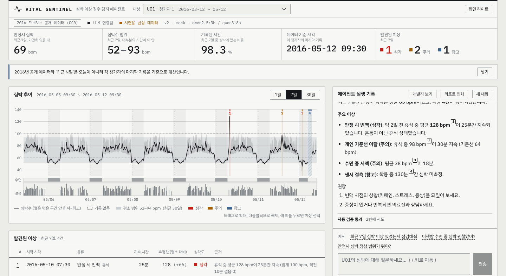

<details><summary>다크 / 모바일 스크린샷</summary>

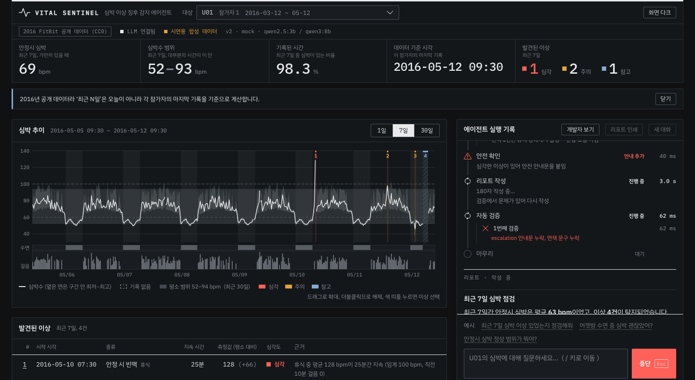
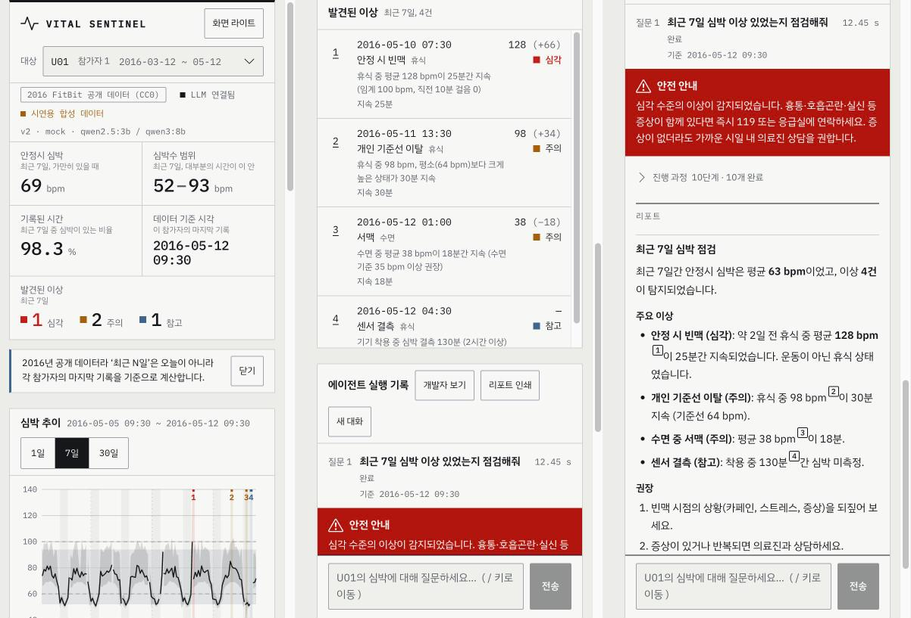

</details>

Kaggle FitBit 분 단위 심박·걸음·수면 데이터에서 안정 시 빈맥, 서맥, 개인 기준 이탈, 안정시 심박 상승 추세, 센서 결측, 극단 심박을 찾는다.
채팅창에 "U05 최근 30일 심박 이상 점검해줘"처럼 말하면 에이전트가 직접 데이터를 조회해 이상 구간을 찾고 가이드라인 근거와 함께 설명하며 위험 수준이면 119 안내문을 코드가 맨 앞에 강제한다.

데이터, 모델, 연구 방법, 로고의 출처와 라이선스는 [NOTICE.md](NOTICE.md)에 정리했다. 이 프로젝트는 **의료기기가 아니다.**
LLM 백엔드는 `fake`(LLM 없음), `ollama`(로컬), `openai`(과금) 세 가지를 바꿔 꽂고 실행 추적과 평가는 LangSmith로 본다.
무엇을 물어볼 수 있는지는 [사용자 가이드](docs/manual_ollma.md), 손으로 쳐 볼 질문은 [회귀 테스트 쿼리](docs/regression_test_queries.md)에 있다.

> **핵심 수치** (표는 [KPI](#kpi와-beforeafter))
> - **에스컬레이션 재현율**: critical 질의에서 119 안내문이 붙은 비율 개발 4/4, 홀드아웃 3/3, 비-critical 오탐 0건.
> - **블라인드 홀드아웃 첫 실행 14/16** (88%, 95% 구간 64~96%, 측정 당시 fast `qwen2.5:3b`). 코드를 보지 않고 만든 질문의 일반화 수치이고 수정 뒤 재실행은 블라인드가 아니다.
> - **v1 → v2 Before/After** (40건 단일 실행): 리포트에 긴급 문구가 있는 비율 0.8(LLM이 스스로 씀) → 1.0(v2는 코드가 넣은 고정 안내문 포함), 진단·복약 단정 2건 → 0건, route 정확도 0.526 → 1.0. 대가는 지연 p50 8.04초 → 12.56초, LLM 호출 1.0 → 3.08회, 토큰 870 → 2,820이다 ([모델 벤치마크 #2](#모델-벤치마크)).

## 목차

- [주요 기능](#주요-기능)
- [주요 실행 방법](#주요-실행-방법)
- [아키텍처 구성도](#아키텍처-구성도)
- [주요 유스케이스별 시퀀스 다이어그램](#주요-유스케이스별-시퀀스-다이어그램)
- [소스 디렉터리 구조](#소스-디렉터리-구조)
- [데이터](#데이터)
- [KPI와 Before/After](#kpi와-beforeafter)
- [모델 벤치마크](#모델-벤치마크)
- [설정](#설정)
- [API](#api)
- [테스트](#테스트)
- [평가](#평가)
- [보안](#보안)
- [품질 보증](#품질-보증)
- [설계 결정](#설계-결정)
- [개발 가이드](#개발-가이드)
- [한계와 로드맵](#한계와-로드맵)
- [데이터와 라이선스](#데이터와-라이선스)
- [감사의 말](#감사의-말)
- [면책](#면책)

## 주요 기능

- **결정론적 이상 탐지**: 5개 유형(`resting_tachycardia`, `bradycardia`, `personal_deviation`, `elevated_resting_trend`, `sensor_gap`)을 LLM 없이 규칙과 통계로 탐지한다. 운동 중·직후 심박 상승은 이상으로 치지 않되 활동으로 설명되지 않는 극단값(210 bpm 이상 등)은 안정 시 빈맥의 극단 빈맥 규칙(`method="extreme"`)이 critical로 올린다. (→ 유스케이스 2)
- **LangGraph 에이전트**: 질문 라우팅(단순 답변 대 분석), 계획과 이중 게이트, 병렬 조회, 데이터 부족 시 1회 재계획, 해석, 서술, 검증, 보호자 알림 승인(HITL)을 12개 노드로 실행한다. 같은 대화의 후속 질문은 코드가 재분석을 막고 이전 결과로 답한다. "U01이랑 U05 비교해줘"처럼 사용자를 여럿 말하면 최대 3명을 병렬로 조회하고 안전 게이트를 사용자별로 돈다. (→ 유스케이스 2, 4, 6)
- **안전(권위) 게이트**: critical 이상이 있으면 LLM 판단과 무관하게 고정 안내문(119/의료진)을 리포트 맨 앞에 강제한다. 에스컬레이션은 저장하지 않고 이상 목록에서 매번 도출하며 탐지 실패를 "이상 없음"으로 쓰지 않는다. (→ 유스케이스 3)
- **Human-in-the-loop 승인**: critical 이상이 있고 `HITL_ENABLED`이면(제공 스크립트·compose 기본값에서는 켜져 있고 설정 기본값은 꺼짐) 보호자 알림(시뮬레이션) 발송 전에 `interrupt`로 멈추고 `POST /chat/approve`의 승인 또는 거절을 기다린다. 안내문은 승인과 무관하게 이미 리포트에 있다. 실제 전송 채널은 없다. (→ 유스케이스 3)
- **Validator**: 근거 없는 수치, 절 단위 진단·복약 단정(한국어와 영어), 단정적 안심 표현, 거짓 "이상 없음", 필수 문구 누락을 규칙으로 검사하고 1회 재작성한다. 소진되면 템플릿 리포트로 대체한다. 스트리밍 문장 가드가 위반 문장을 화면에 내보내지 않는다. 이상이 있는 리포트에서는 LLM 본문에서 사실 서술(닫힌 어휘 검사 통과)만 남기고 조언·평가·안심·진료 문장은 지운 뒤 대응 안내를 코드가 쓴다 (허용 목록). (→ 유스케이스 3)
- **MCP 서버 2개**: `vitals`(Tool 5개: 사용자·요약·탐지·시계열·연구 사건 라벨, Prompt 1개)와 `guidelines`(Resource 3개, 의미 검색 Tool `search_guidelines`)를 stdio subprocess로 띄운다. (→ 유스케이스 2)
- **RAG(가이드라인 의미 검색)**: 가이드라인 19개 문서(52청크)를 bge-m3로 임베딩해 질문과 가까운 대목을 찾는다. Ollama가 닿지 않거나 LLM을 끄면 임베딩을 부르지 않고 키워드 검색으로 내려가며 질의 임베딩은 3초 상한이고 인덱스는 백그라운드에서 만든다. (→ 유스케이스 1)
- **실시간 SSE**: 라우팅, 계획, 게이트, 재계획, 이상 목록, 안전 에스컬레이션, 토큰, 검증 결과를 이벤트로 스트리밍하고 프론트가 단계별 실행 기록으로 보여준다. (→ 유스케이스 5)
- **LLM 교체와 장애 내성**: `LLM_BACKEND`로 `fake`(LLM 없음), `ollama`(로컬), `openai`(과금)를 바꿔 꽂는다. LLM이 없거나 죽어도 키워드 라우팅, 규칙 계획, 템플릿 리포트로 끝까지 동작한다. (→ 유스케이스 2)
- **Before/After 비교용 v1**: `SUPERVISOR_VERSION=v1`은 라우팅·게이트·안전 게이트·검증이 없는 선형 기준선이다 (비교 수치는 [KPI와 Before/After](#kpi와-beforeafter)).
- **개인정보 최소화**: 가명 ID, LLM에는 집계 사실만 전달, 로컬 LLM(Ollama) 기본 사용.
- **대화 기억과 요약**: checkpointer가 `thread_id`별 상태를 저장하고 같은 대화에서 말한 이름·나이는 되물으면 코드가 기록에서 답하며(제공 스크립트·compose 기본값인 sqlite에서는 서버를 재시작해도 유지, 설정 기본값은 memory), 미요약 메시지가 10개를 넘으면 오래된 대화를 fast LLM으로 요약해 컨텍스트 상한을 지킨다 (`SUMMARIZE_AFTER_MESSAGES`). (→ 유스케이스 6)
- **재현 가능한 평가**: 실데이터 위에 이상을 주입해 라벨을 만들고 튜닝 시드와 홀드아웃 시드를 분리하며 코드를 보지 않고 만든 블라인드 홀드아웃으로 일반화를 점검한다. (→ [사용자 가이드](docs/manual_ollma.md)의 운영자용 절)

## 주요 실행 방법

### 사전 준비

| 도구 | 버전 | 언제 필요한가 |
|---|---|---|
| Git | 아무 버전 | 저장소 받기 |
| Python | 3.11 (또는 [uv](https://docs.astral.sh/uv/)가 있으면 자동으로 받는다) | 백엔드 |
| Node.js | 22 이상 | 웹 화면 |
| Ollama | 최신 | 로컬 LLM을 쓸 때만. 없으면 `fake` 모드(규칙 기반 리포트)로 동작한다 |
| Docker Desktop 또는 Docker Engine + Compose v2 | 최신 | Docker로 한 번에 띄울 때만 |

```bash
git clone https://github.com/kimddong23/skala-15w-AI_Agent_Capstone_miniproject.git
cd skala-15w-AI_Agent_Capstone_miniproject
```

### 운영체제별 실행

| 운영체제 | 권장 방법 | 확인 범위 |
|---|---|---|
| macOS (Apple Silicon·Intel) | 아래 `sh/` 스크립트 | 새로 clone한 저장소에서 설치·테스트·기동 확인 |
| Linux (x86_64, arm64) | 아래 `sh/` 스크립트 | x86_64 컨테이너에서 clone부터 설치·테스트·기동 확인 |
| Windows 10/11 | Docker Desktop의 `docker compose up -d --build`, 또는 WSL2(Ubuntu)에서 Linux와 같은 명령 | 이미지는 amd64·arm64 공용이라 Docker 경로는 같다. Windows 네이티브 PowerShell 경로는 아래 명령만 정리했고 직접 실행해 보지는 않았다 |

Windows에서 WSL2나 Docker 없이 PowerShell로 바로 실행하려면 스크립트 대신 다음을 쓴다(`.venv/bin/python` 대신 `.venv\Scripts\python`).

```powershell
py -3.11 -m venv .venv
.venv\Scripts\python -m pip install -r requirements.txt
$env:LLM_BACKEND = "fake"; $env:CHECKPOINTER = "sqlite"; $env:HITL_ENABLED = "true"
.venv\Scripts\python -m uvicorn app.api.main:app --host 127.0.0.1 --port 8100
# 새 PowerShell 창에서
cd frontend; npm ci; npm run dev          # http://localhost:8600 (백엔드 8100으로 프록시)
```

로컬 LLM을 쓰려면 Ollama를 설치하고 `ollama pull qwen3:0.6b`, `ollama pull qwen3:8b`, `ollama pull bge-m3`를 받은 뒤 `$env:LLM_BACKEND = "ollama"`로 띄운다. 저장소의 `.gitattributes`가 줄바꿈을 LF로 고정하므로 Windows에서 받아도 셸 스크립트와 Docker 빌드가 깨지지 않는다.

**맨 처음 한 번만**: 저장소를 받았다면 `.venv`부터 만든다. 가공 데이터(`data/processed/`)는 저장소에 들어 있어서 Kaggle 계정 없이 바로 실행된다.

```bash
bash sh/setup_venv.sh                                                     # .venv 생성 + 의존성 설치
# (선택) 가공 데이터를 처음부터 다시 만들 때만. 자세한 절차는 data/README.md
kaggle datasets download -d arashnic/fitbit --unzip -p data/raw && .venv/bin/python -m app.data.prepare
```

| 순번 | 방법 | 명령 | 비용 | 용도 |
|---|---|---|---|---|
| 1 | Python 가상환경 준비 | `bash sh/setup_venv.sh` | 없음 | `.venv` 생성 + `requirements.txt` 설치 (최초 1회, 이미 있으면 설치만 재확인) |
| 2 | 로컬 Ollama 모델 준비 | `bash sh/setup_ollama.sh` | 없음 (로컬 추론, 모델 다운로드 수 GB) | `qwen3:0.6b`(fast), `qwen3:8b`(quality), `bge-m3`(임베딩)를 없는 것만 받는다. 실행 중인 Ollama 서버는 종료하지 않는다 |
| 3 | 데이터 준비 (선택) | `.venv/bin/python -m app.data.prepare` | 없음 (Kaggle 원본 588MB 필요) | 원본 CSV에서 가공 데이터와 평가 라벨을 다시 만든다. 저장소에 결과가 들어 있어 보통 건너뛴다 |
| 4 | 에이전트만 기동 (LLM 없음) | `bash sh/run_agent_fake.sh` | 없음 | Ollama 없이 규칙 기반 리포트로 동작. 처음 써 보기에 가장 쉽다 |
| 5 | 에이전트만 기동 (로컬) | `bash sh/run_agent_ollma.sh` | 없음 | 서버만 띄워 두고 `curl`이나 브라우저로 시험 (`http://127.0.0.1:8100`) |
| 6 | 에이전트만 기동 (OpenAI) | `bash sh/run_agent_openai.sh` | **과금** | 위와 같되 실제 API 사용 (y/N 확인, `.env`의 `OPENAI_API_KEY`) |
| 7 | 브라우저 채팅 화면 | `bash sh/run_frontend.sh` (4~6번 중 하나를 먼저) | 백엔드에 따름 | `http://localhost:8600`에서 실제 UI로 사용 |
| 8 | 백엔드 없이 화면만 (mock) | `MOCK=1 bash sh/run_frontend.sh` | 없음 | 기록된 시나리오를 재생한다. 라이브가 아니다 |
| 9 | 한 번에 (Docker) | `docker compose up -d --build` | 없음 | 백엔드 + 프론트엔드. 접속 `http://localhost:8600`. Ollama는 호스트 것을 쓴다 |

- 모든 스크립트는 `.env`가 없으면 `cp .env.example .env` 후 값을 채우라고 안내한다. 기본값 그대로 동작한다.
- 스크립트는 **자기가 띄운 프로세스만** 종료한다. 포트가 이미 쓰이면 다른 프로세스를 죽이지 않고 알려 준 뒤 멈춘다. 포트는 `BACKEND_PORT`(기본 8100), `FRONTEND_PORT`(기본 8600)로 바꾼다.
- 백엔드 스크립트마다 LangSmith 프로젝트 이름이 다르다(`vital-sentinel-fake` 등). 켜 두면 백엔드별 트레이스가 섞이지 않는다.
- 세 백엔드 스크립트는 대화 기억을 sqlite 파일(`data/checkpoints.sqlite`)에 저장하므로 서버를 껐다 켜도 같은 `thread_id`로 이어진다. 끄려면 `CHECKPOINTER=memory bash sh/run_agent_fake.sh`처럼 준다. 아래 수동 실행의 기본값은 메모리다.
- OpenAI는 과금이라 확인 없이는 시작하지 않는다. 스크립트는 y/N을 묻고 `.env`나 셸의 `OPENAI_CONFIRM`은 일부러 무시한다. Docker로 한 번만 띄울 때는 `docker compose run --rm -e OPENAI_CONFIRM=yes -e LLM_BACKEND=openai --service-ports backend`처럼 그 프로세스에서만 준다 (자세한 내용은 사용자 가이드).

> 켜 둔 뒤에 무엇을 물어볼 수 있는지는 [사용자 가이드](docs/manual_ollma.md), 손으로 쳐 볼 질문 목록은 [회귀 테스트 쿼리](docs/regression_test_queries.md).

### 수동 실행 (스크립트 없이)

스크립트가 하는 일을 직접 하는 방법이다. 포트는 스크립트와 같게 백엔드 8100, 프론트엔드 8600이다.

```bash
uv venv --python 3.11 && uv pip install --python .venv/bin/python -r requirements.txt
.venv/bin/uvicorn app.api.main:app --host 127.0.0.1 --port 8100        # 백엔드 (LLM_BACKEND 기본 ollama)
LLM_BACKEND=fake .venv/bin/uvicorn app.api.main:app --port 8100         # LLM 없이
cd frontend && npm install && npm run dev                                # 화면 http://localhost:8600 (/api 프록시 대상 8100)
cd frontend && npm run dev:mock                                          # 백엔드 없이 mock 재생
```

백엔드가 떠 있는지는 `curl -s localhost:8100/health`로 본다. 질문 보내기는 아래 [API](#api) 절을 본다.

### 실행 문제 해결

| 증상 | 원인과 해결 |
|---|---|
| `.venv 가 없습니다` | 1번을 먼저: `bash sh/setup_venv.sh` |
| `모델 … 설치되어 있지 않습니다` | 2번: `bash sh/setup_ollama.sh` (또는 LLM 없이 `run_agent_fake.sh`) |
| 화면에 "LLM 미연결 — 기본 리포트 모드" | 정상 동작이다(규칙 기반 리포트). 원인은 화면에 한 줄로 표시된다 |
| `포트 8100 … 이미 쓰고 있습니다` | 다른 프로그램이 쓰는 중이다. `BACKEND_PORT=8110`으로 바꿔 실행하고 프론트도 같은 값으로 `BACKEND_PORT=8110 bash sh/run_frontend.sh` |
| 프론트가 `백엔드가 응답하지 않습니다` | 백엔드(4~6번)를 먼저 켠다. 화면만 보려면 `MOCK=1 bash sh/run_frontend.sh` |
| Docker에서 LLM이 안 붙는다 | 호스트 Ollama(`host.docker.internal:11434`)를 쓴다. 없으면 기본 리포트 모드로 뜬다. 컨테이너 Ollama: `DOCKER_OLLAMA_URL=http://ollama:11434 docker compose --profile ollama up -d --build` (GPU는 `docker-compose.gpu.yml`을 함께 지정) |
| 가공 데이터가 없다고 한다 | `data/processed/`는 저장소에 있다. 지워졌다면 `data/README.md`의 절차로 다시 만든다 |

데이터를 `curl`로 직접 확인하려면 다음처럼 한다.

```bash
curl -s localhost:8100/health
curl -sN -X POST localhost:8100/chat/stream -H 'Content-Type: application/json' \
  -d '{"message":"어젯밤 수면 중 심박 괜찮아?","user_id":"U05"}'      # 진행 과정이 SSE로 흐른다
```

같은 대화를 이어 가려면 응답의 `thread_id`를 다음 요청에 넣는다. LangSmith 추적은 `.env`에서 `LANGCHAIN_TRACING_V2=true`와 키를 넣으면 켜진다(질문·집계 요약이 외부로 전송된다).

## 아키텍처 구성도

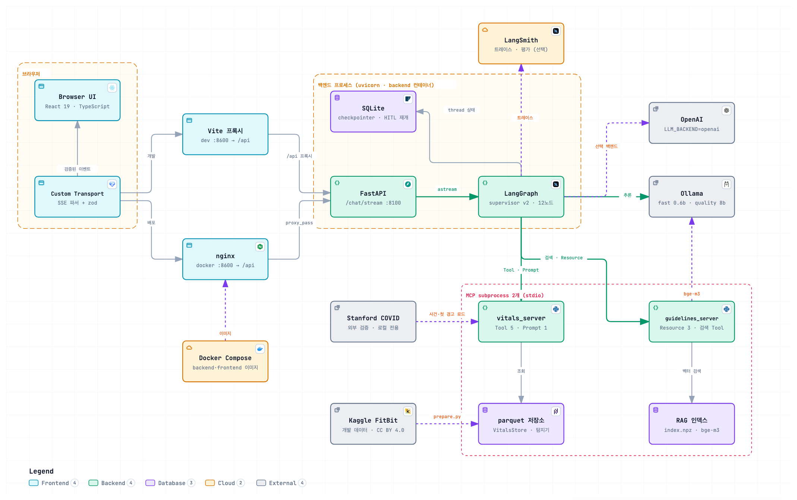

아래는 같은 구조의 텍스트 대체본(mermaid)이다.

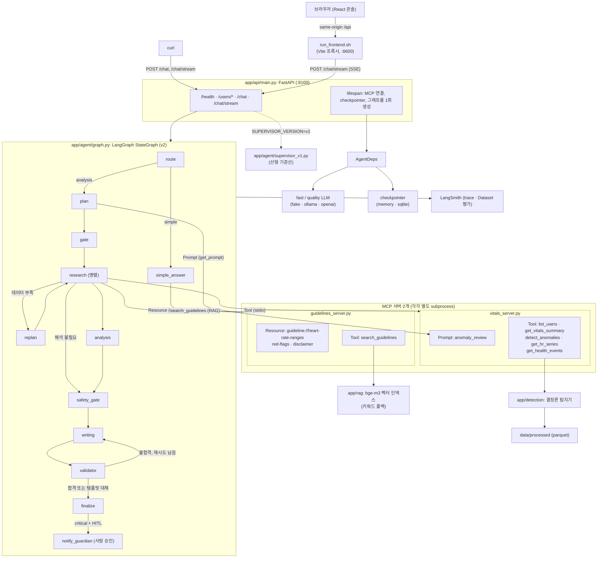

- **싱글턴**: MCP 연결, checkpointer, 컴파일된 그래프를 `lifespan`에서 한 번만 만들어 `app.state`에 둔다. 요청마다 subprocess를 띄우지 않는다.
- **의존성 주입**: 노드는 `AgentDeps`(도구, LLM, checkpointer, 버전)를 받아 동작한다. 테스트는 fake를 꽂아 LLM 없이 결정론적으로 돈다.
- **백엔드 교체**: `LLM_BACKEND=fake|ollama|openai`로 그래프 코드를 바꾸지 않고 LLM을 갈아 끼운다. LLM이 죽어도 키워드 라우팅과 템플릿 리포트로 끝까지 간다.
- **버전 토글**: `SUPERVISOR_VERSION=v1|v2`. v1은 라우팅·게이트·안전 게이트·검증이 없는 선형 기준선이라 Before/After 비교에만 쓴다. v1로 켜면 화면 위에 경고(빨간 띠)가 뜬다.
- **MCP는 별도 프로세스**: `vitals`(Tool 5, Prompt 1)와 `guidelines`(Resource 3, Tool `search_guidelines`)를 stdio subprocess로 띄우고 클라이언트가 이름으로 찾아 쓴다. 한 서버가 죽어도 나머지는 동작한다. `guidelines`가 죽으면 면책은 코드 상수로, 일반 질문은 번들 요약으로 답하고 `vitals`가 죽으면 조회 태스크가 `task_failed`로 격리되어 리포트가 "이상 탐지를 실행하지 못해 판단할 수 없다"고 밝힌다. `plan` 노드는 Prompt `anomaly_review`를 표준 점검 절차로 가져와 계획에 쓰고 못 가져오면 내장 절차로 계획한다.
- **탐지는 코드, 해석은 LLM**: 이상 구간은 결정론적 규칙이 찾고 LLM은 근거를 풀어 쓰기만 한다.
- **안전 게이트**: critical 이상이 있으면 LLM 판단과 무관하게 코드가 119 안내문을 리포트 맨 앞에 넣는다. `analysis`를 건너뛰어도 `safety_gate`는 반드시 거친다.
- **검증기와 템플릿 대체**: `validator`가 근거 없는 수치, 진단·복약 단정, 단정적 안심을 잡아 1회 재작성시키고 그래도 실패하면 템플릿 리포트로 대체한다.
- **대화 기억**: checkpointer가 `thread_id`별 상태를 저장한다. 후속 질문은 코드가 재분석을 막고 직전 결과로 답한다.

LangGraph 노드 그래프는 `app/agent/graph.py`(v2)와 `supervisor_v1.py`(v1)를 그대로 옮긴 것이다.

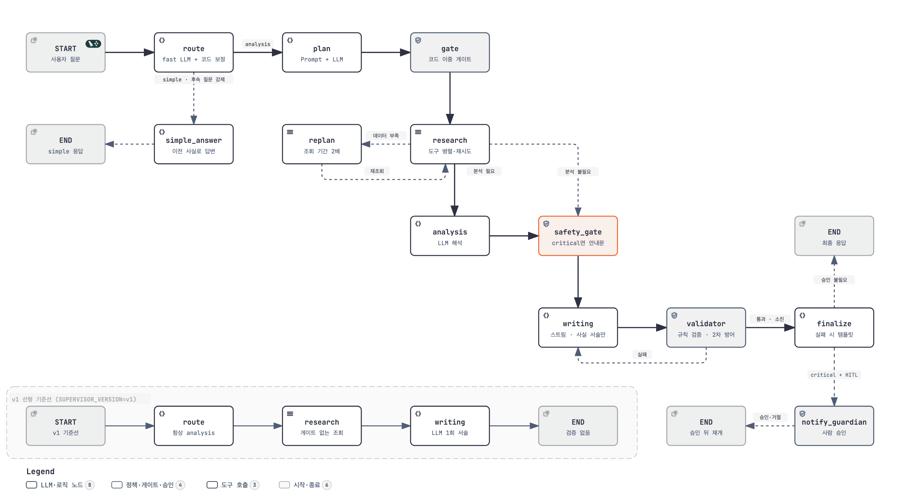

자세한 그림(PNG와 확대·검색이 되는 인터랙티브 HTML): [시스템 구성도](docs/architecture/system-architecture.html) · [종단 간 흐름](docs/architecture/e2e-system-flow.html) · [노드 그래프](docs/architecture/agent-graph.html) · [저장소 구조](docs/architecture/repo-structure.html) · [데이터와 평가 파이프라인](docs/architecture/data-and-eval-pipeline.html) · [SSE 시퀀스](docs/architecture/sse-sequence.html).

## 주요 유스케이스별 시퀀스 다이어그램

먼저 질문 한 건이 화면에서 시작해 승인 뒤 재개까지 지나가는 종단 간 흐름이다. 점선은 화면으로 가는 SSE 이벤트와 LangSmith로 가는 트레이스다.

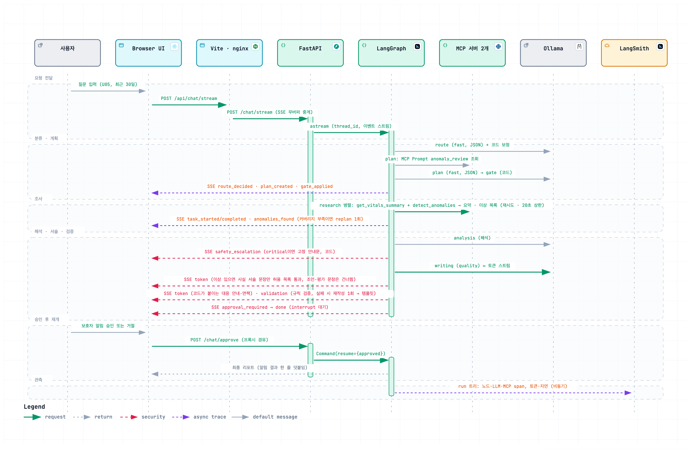

번호는 [사용자 가이드](docs/manual_ollma.md)의 사용 예와 같다. 화면 캡처와 "실제로 일어난 일"은 그쪽에 있고 여기서는 흐름만 본다.

### 1. 일반 질문에 바로 답하기

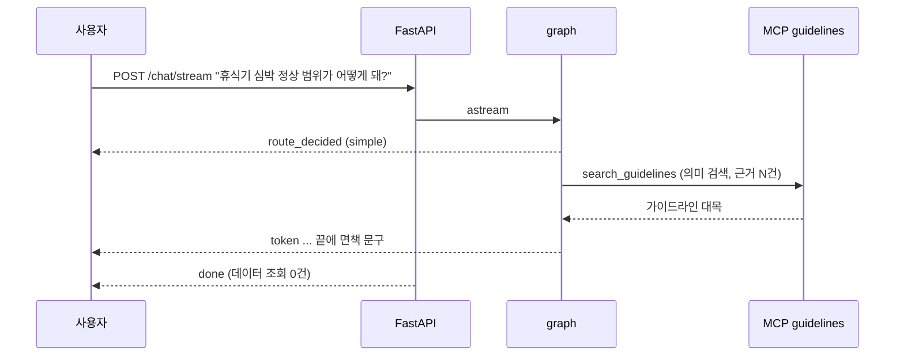

### 2. 사용자 심박 이상 점검

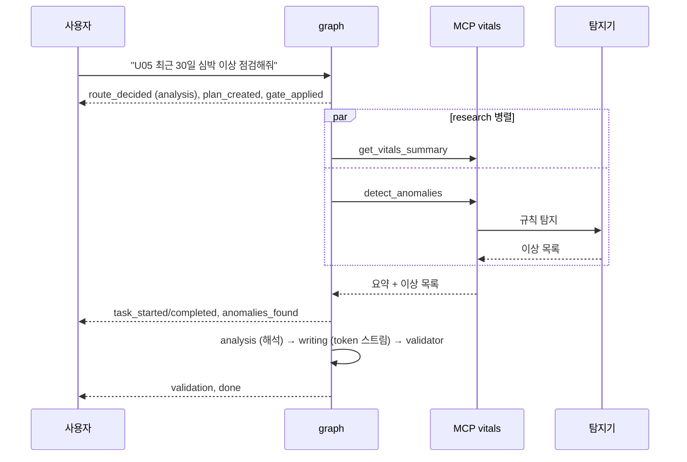

### 3. 위험 수치에서 안내를 코드가 강제하고 보호자 알림은 사람이 승인

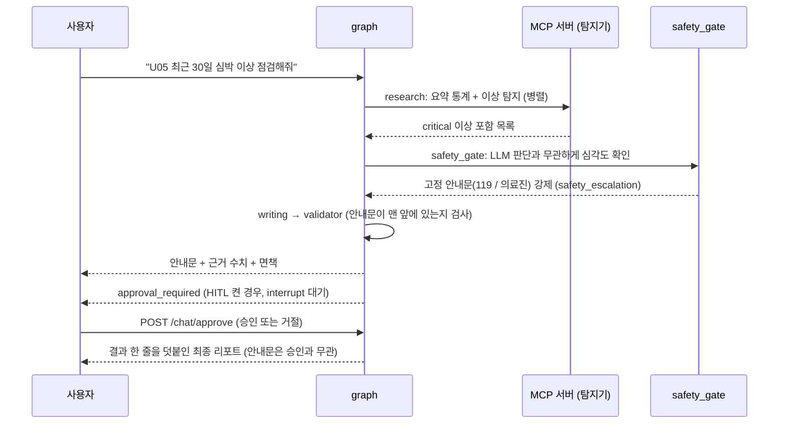

### 4. 데이터가 부족하면 기간을 넓혀 다시 조사

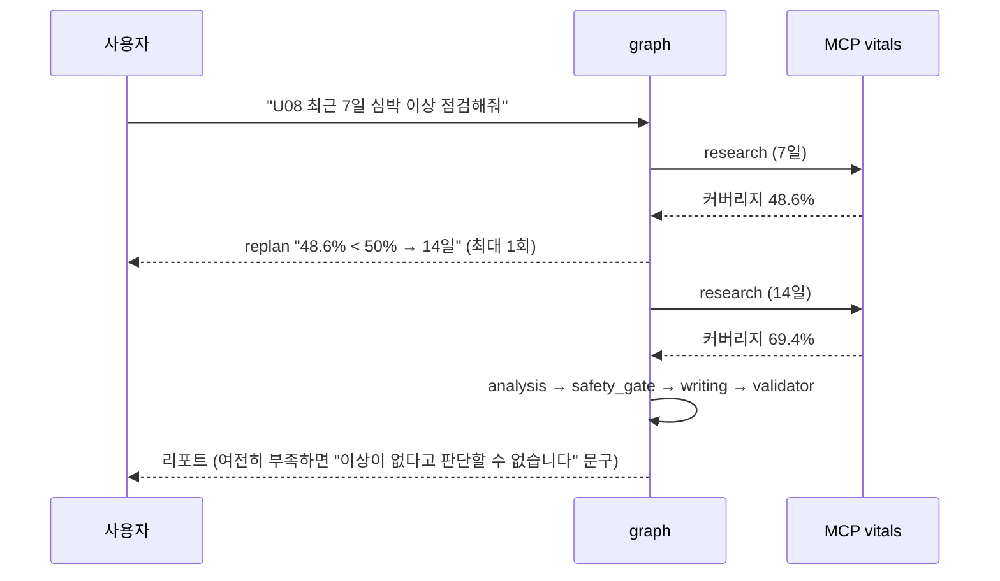

### 5. 진행 과정을 실시간으로 보기 (웹 화면)

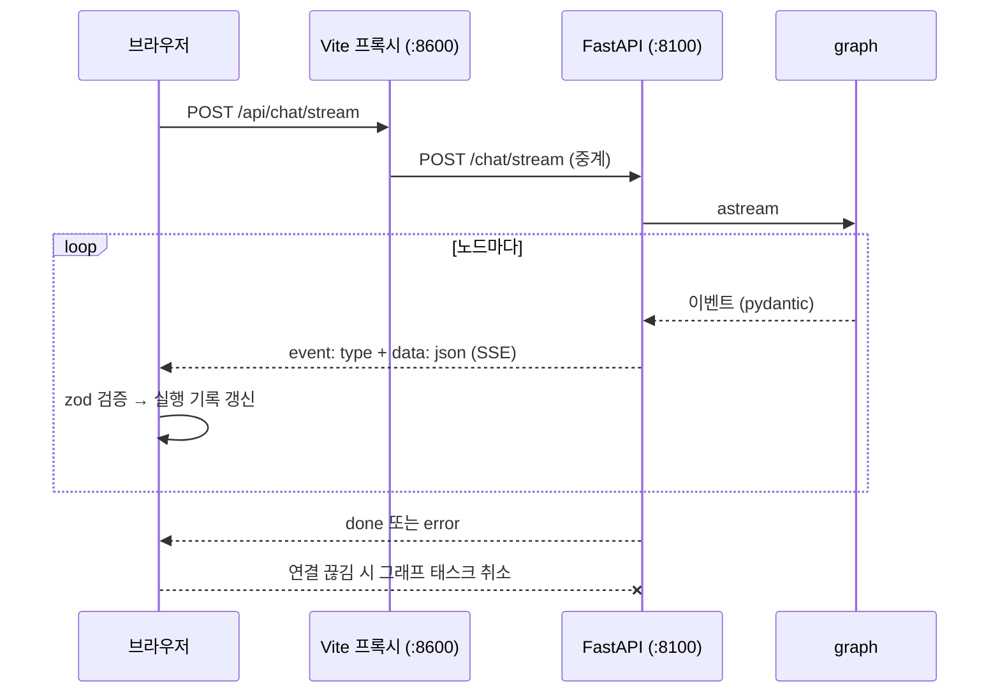

### 6. 같은 대화에서 이어 묻기 (서버 재시작 뒤에도)

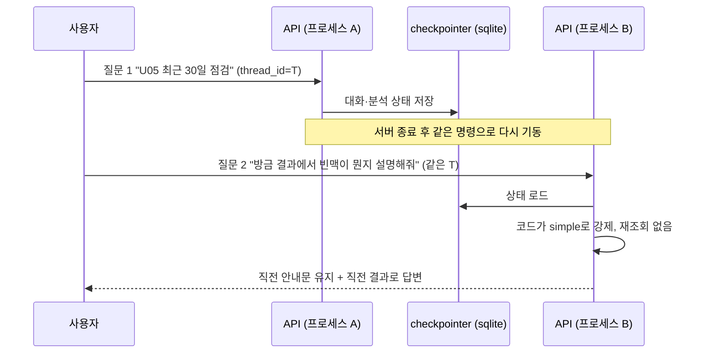

## 소스 디렉터리 구조

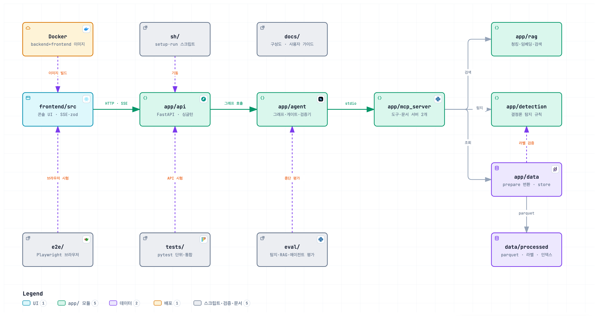

화살표는 실제 import 방향이다(에이전트는 MCP 서버를 import하지 않고 stdio로 호출한다). 파일 단위 트리는 아래와 같다.

```text
health_anomaly_agent/
├── README.md                 # 이 문서
├── requirements.txt          # 버전 고정 의존성
├── .env.example              # 환경변수 견본 (.env 는 커밋하지 않음)
├── .gitleaks.toml            # 비밀값 검사 설정 (pre-commit 훅은 scripts/install-hooks.sh)
├── Dockerfile, docker-compose.yml, docker-compose.gpu.yml   # 한 줄 기동 (Ollama 프로필, GPU 선택)
│
├── app/
│   ├── config.py             # 환경변수 → Settings
│   ├── api/main.py           # FastAPI: lifespan 싱글턴, /health·/users/*·/chat·/chat/stream(SSE)
│   ├── agent/
│   │   ├── graph.py          # LangGraph 조립 (노드·조건부 엣지만, v1/v2 선택)
│   │   ├── nodes.py          # 노드 구현 (route … finalize), SSE 이벤트 방출
│   │   ├── gates.py          # 라우팅 폴백·이중 게이트·안전 게이트·재계획 판단 (규칙)
│   │   ├── validator.py      # 리포트 규칙 검증 (근거 수치·진단 단정·안심 표현)
│   │   ├── report.py         # 사실 요약·템플릿 리포트·고정 문구 조립
│   │   ├── deps.py           # AgentDeps 의존성 번들 (fast/quality LLM, 도구, checkpointer, 버전)
│   │   ├── supervisor_v1.py  # v1 선형 기준선 (Before/After 비교용)
│   │   ├── llm.py            # LLM 인터페이스·Ollama 백엔드·팩토리 (fake|ollama|openai)
│   │   ├── fake_llm.py       # LLM_BACKEND=fake: 결정론 응답
│   │   ├── openai_llm.py     # LLM_BACKEND=openai: 원격 API (과금)
│   │   ├── usage.py          # 요청 단위 호출 수·토큰·지연·참고 비용 계량
│   │   ├── toolbox.py        # MCP stdio 연결 → ToolBox 어댑터 (이름으로 도구·리소스 탐색)
│   │   ├── retry.py          # transient 오류만 지수 백오프 재시도
│   │   ├── checkpointer.py   # memory|sqlite|postgres 체크포인터
│   │   ├── events.py         # SSE 이벤트 14종 스키마
│   │   └── state.py          # AgentState
│   ├── mcp_server/
│   │   ├── vitals_server.py      # MCP vitals: Tool 5 (사용자·요약·탐지·시계열·연구 사건), Prompt 1
│   │   ├── guidelines_server.py  # MCP guidelines: Resource 3, Tool search_guidelines
│   │   ├── server.py             # 두 서버를 한 프로세스로 합친 호환 서버 (테스트·수동 점검용)
│   │   └── guidelines/*.md       # 가이드라인 문서 19개 (Resource·RAG 코퍼스)
│   ├── rag/                  # 가이드라인 청크·bge-m3 임베딩 인덱스·검색 (키워드 폴백)
│   ├── detection/
│   │   ├── detector.py       # 결정론 탐지 (유형 5종 + 극단 빈맥)
│   │   ├── baseline.py       # 개인 기준선·맥락(휴식/수면/운동)
│   │   └── research.py       # 연구 기법 (EllipticEnvelope, CuSum)
│   └── data/
│       ├── prepare.py        # 원본 CSV → 분 단위 parquet, 가명화, 이상 주입·라벨
│       └── store.py          # VitalsStore 조회
│
├── frontend/                 # Vite + React + TS 콘솔 (SSE 파서 + zod), docs/screenshots/
├── eval/                     # 평가 하네스와 results/
│   ├── detection_eval.py, robustness_benchmark.py   # 탐지기 재현율·강건성 몬테카를로
│   ├── langsmith_eval.py     # 에이전트 종단 평가 26건 (LangSmith 또는 --offline)
│   ├── heldout_eval.py       # 블라인드 홀드아웃 16건 (heldout_examples.json)
│   ├── compare_versions.py   # v1 대 v2 Before/After
│   ├── rag_eval.py           # 키워드 대 RAG 검색 정확도 (rag_questions.json)
│   ├── latency_bench.py      # 지연 최적화 변형 비교
│   └── judge_eval.py, promote_failures.py   # 서술 품질 judge 평가, 실패 예제 회귀셋 승격
├── tests/                    # pytest (단위·통합·API E2E)
├── e2e/                      # Playwright 브라우저 E2E
├── scripts/install-hooks.sh  # gitleaks pre-commit 훅 설치
├── data/                     # processed/ (가공 parquet·labels.json·id_map.json·rag 인덱스, git 포함), raw/ (Kaggle 원본, git 제외), external/ (Stanford, git 제외)
├── sh/
│   ├── _common.sh            # 공용 함수 (자기 프로세스만 종료, 포트 검사)
│   ├── setup_venv.sh         # .venv 생성 + 설치 (맨 처음 1회)
│   ├── setup_ollama.sh       # 모델 준비 (있으면 재사용)
│   ├── run_agent_fake.sh     # 백엔드 기동: LLM 없음
│   ├── run_agent_ollma.sh    # 백엔드 기동: 로컬 Ollama
│   ├── run_agent_openai.sh   # 백엔드 기동: OpenAI (과금, y/N)
│   └── run_frontend.sh       # 화면 기동 (:8600, MOCK=1 지원)
└── docs/
    ├── manual_ollma.md       # 사용자 가이드: 무엇을 물어볼 수 있나 (캡처)
    ├── regression_test_queries.md  # 손으로 쳐 보는 회귀 쿼리 목록
    ├── image_usecase/        # 사용자 가이드 캡처
    └── architecture/         # 다이어그램 PNG·인터랙티브 HTML
```

## 데이터

데이터셋은 둘이다. FitBit은 서비스와 개발 평가에 쓰는 기본 데이터이고 Stanford는 동결한 탐지기를 한 번 적용해 보는 외부 검증용이라 탐지기 튜닝에는 쓰지 않는다. 앱의 같은 `VitalsStore`가 두 데이터셋을 모두 읽는다.

| | FitBit (개발·서비스) | Stanford COVID-19 웨어러블 (외부 검증) |
|---|---|---|
| 역할 | 에이전트·화면의 기본 데이터. 평가용 이상을 합성 주입 | 실제 질병 사건(증상·진단·회복일)에 탐지기를 튜닝 없이 적용 |
| 사용자 ID | `U01`~`U15` (가명) | `S001`~ (가명) |
| 라이선스 표기 | 원본 Zenodo CC BY 4.0 (Kaggle 재배포본에는 다른 표기가 있으나 원본의 CC BY 4.0을 따라 저작자 표시) | **표기 없음** |
| 저장소 포함 | 가공본 포함 (`data/processed/`, 약 8MB) | 포함하지 않음 (`data/external/`, git 제외). 다운로드·변환 스크립트와 집계 지표만 공개 |

### FitBit (개발·서비스)

**출처**
- 이름: Fitbit Fitness Tracker Data.
- **원본 출처**: Furberg, R., Brinton, J., Keating, M., Ortiz, A. (2016). *Crowd-sourced Fitbit datasets 03.12.2016-05.12.2016*. Zenodo. [doi:10.5281/zenodo.53894](https://doi.org/10.5281/zenodo.53894). 라이선스 CC BY 4.0 (2026-10-20 Zenodo API로 확인).
- **재배포처**: Kaggle [`arashnic/fitbit`](https://www.kaggle.com/datasets/arashnic/fitbit)에서 내려받았다. Kaggle의 표기는 원본과 다르므로 원본의 CC BY 4.0을 따른다.
- **조건 준수**: 두 표기가 다르므로 더 엄격한 CC BY 4.0을 따른다. 원저자를 이 문서와 `data/README.md`에 밝히고 변경 사항(초 단위 심박의 분 단위 집계, 걸음·수면 결합, 사용자 가명화, 평가용 합성 이상과 정답 라벨 주입)을 명시한다. 가공본에는 주입된 합성 이상이 섞여 있으므로 원자료로 오해하지 않도록 `vitals_minute_clean.parquet`(주입 없음)을 따로 둔다.

**기간·참가자·기기·해상도**

| 항목 | 값 |
|---|---|
| 수집 방식 | Amazon Mechanical Turk 설문 응답자 중 30명이 추적기 자료를 제출 (Zenodo 설명) |
| 내보내기 기간 | 2016-03-12 ~ 2016-05-12 (두 폴더: 3.12~4.11, 4.12~5.12) |
| 기기 | 여러 종류의 Fitbit 추적기 (모델은 자료에 표기되지 않음) |
| 우리가 쓴 참가자 | 심박 기록이 있는 15명 (원본 심박 파일의 `Id` 15개) |
| 우리 가공본의 심박 기간 | 2016-03-29 ~ 2016-05-12, 사용자별 일수·커버리지 편차 큼 (한계 절 참고) |
| 원본 해상도 | 심박은 초 단위(표본은 약 5초 간격), 걸음·수면은 1분 단위 |
| 원본 크기 | 심박 3,638,339행 (중복 제거 뒤 3,614,915행), 걸음 2,770,620행, 수면 387,080행 (두 기간 합) |
| 가공본 크기 | 482,507행(원본 그대로) / 482,078행(주입 포함), 심박이 있는 분 471,810개 |

**사용한 원본 파일** (`data/raw/*/*/`, 두 기간 폴더의 같은 이름 파일을 이어 붙인다)

| 파일 | 컬럼 | 타입·의미 | 쓰임 |
|---|---|---|---|
| `heartrate_seconds_merged.csv` | `Id` | 정수, 원본 참가자 ID | 사용자 키. 가명화 대상 |
| | `Time` | 문자열 `m/d/Y h:mm:ss AM/PM`, 기기 로컬 시각 | 분 단위로 내림해 집계 |
| | `Value` | 정수 bpm | 분별 평균·최소·최대·표본 수 |
| `minuteStepsNarrow_merged.csv` | `Id`, `ActivityMinute`, `Steps` | ID, 같은 형식의 분 시각, 분당 걸음 | 걸음이 0보다 큰 분만 사용 (심박이 있는 사용자만) |
| `minuteSleep_merged.csv` | `Id`, `date`, `value`, `logId` | ID, 분 시각(초가 `:30`인 행이 있어 분으로 내림), 수면 상태(1 수면, 2 뒤척임, 3 깨어 있음), 기록 번호 | `value == 1` 인 분만 `asleep=True`. `logId`는 쓰지 않음 |

**전처리 단계** (`app/data/prepare.py`, 시드 고정이라 같은 결과가 나온다)
1. 두 기간 폴더의 같은 이름 CSV를 이어 붙인다.
2. 시각 문자열을 시간대 변환 없이 naive 로컬 시각으로 읽고 분 단위로 내린다.
3. 심박은 `(Id, Time)` 중복을 지우고 분마다 평균·최소·최대·표본 수로 집계한다 (초 단위에서 분 단위로).
4. 걸음은 `(Id, 분)` 중복을 지우고 걸음이 0보다 큰 분만 남긴다. 심박 기록이 없는 사용자의 걸음은 버린다.
5. 수면은 `(Id, 분)` 중복을 지우고 `value == 1` 인 분만 수면으로 표시한다.
6. 심박·걸음을 합치고 수면을 붙인다. 사용자의 심박 기록 구간 밖의 행은 버린다.
7. **희소 저장**: 심박이 있는 분과 걸음이 있는 분만 저장한다. 걸음만 있는 분은 `hr_mean`=NaN, `hr_n`=0이다. 이 분이 센서 결측과 미착용을 구분하는 근거다. 걸음 없는 분의 걸음은 0으로 복원할 수 있다.
8. **주입 라벨**: 평가용 합성 이상 14건을 실제 데이터 위에 덮어쓴다 (추세 2, 안정 시 빈맥 3, 서맥 3, 개인 기준 이탈 3, 센서 결측 3). 사용자는 시드 고정 라운드 로빈으로 정하고 이벤트 사이를 90분 이상 띄우며 한 사용자에 최대 3건이다. 길이·크기는 `prepare.SPECS`에 있다.
9. **가명화**: 정렬한 원본 `Id`를 `U01`~`U15`로 바꾼다 (`id_map.json`).
10. 산출물 4개를 쓴다: `vitals_minute_clean.parquet`(주입 없음), `vitals_minute.parquet`(주입 포함), `labels.json`, `id_map.json`.

서머타임은 가공 단계에서 고치지 않는다. 탐지기(`app/detection/baseline.py`)가 미국 봄 전환일(3월 둘째 일요일) 02:00~02:59를 존재하지 않는 시간으로 보고 격자에서 뺀다. 이 가공본의 심박 기록은 3월 29일 이후라 해당 날짜(2016-03-13)가 들어 있지 않다.

**가공 컬럼 사전** (`vitals_minute.parquet`. 분 단위 희소 형식, 행 순서는 `user_id`, `ts`)

| 컬럼 | 타입 | 단위·의미 | 결측 처리 |
|---|---|---|---|
| `user_id` | 문자열 | 가명 사용자 `U01`~`U15` | 없음 |
| `ts` | datetime64[ns] | 기기 로컬 시각(시간대 없음), 분 단위. 조회 구간은 (시작, 끝] | 없음 |
| `hr_mean` | float64 | 그 분의 심박 평균 (bpm). 원본 범위는 36.8~202.2 | 심박이 없는 분은 NaN |
| `hr_min` | float64 | 그 분의 심박 최소 (bpm) | 같음 |
| `hr_max` | float64 | 그 분의 심박 최대 (bpm) | 같음 |
| `hr_n` | int32 | 그 분에 들어 있던 초 단위 심박 표본 수 (최대 54) | 심박이 없으면 0 |
| `steps` | int32 | 분당 걸음 수 | 행이 없는 분은 0으로 해석 |
| `asleep` | bool | 수면 기록 상태(`minuteSleep.value == 1`) | 수면 기록이 없으면 False |
| `injected` | 문자열 또는 None | 주입 이벤트 ID(`EVT-01`...). 평가 전용 | 주입이 아니면 None |

`injected`는 정답 라벨이라 앱(`VitalsStore`)이 읽을 때 제거하고 탐지기에도 전달하지 않는다 (라벨 누수 방지). 앱이 읽는 컬럼은 `ts`, `hr_mean`, `hr_min`, `hr_max`, `hr_n`, `steps`, `asleep`이다.

**`labels.json`** (주입 이벤트 14건의 정답): 배열이고 항목은 아래 필드를 가진다.

| 필드 | 의미 |
|---|---|
| `event_id` | `EVT-01`~. `injected` 컬럼과 같은 값 |
| `user_id` | 가명 사용자 |
| `type` | `resting_tachycardia`, `bradycardia`, `personal_deviation`, `elevated_resting_trend`, `sensor_gap` |
| `start`, `end` | ISO 시각(naive). `end`는 마지막 분을 포함 |
| `severity` | `warning`, `critical`, `info` (기대 심각도) |
| `params` | 주입 상세. `kind`(`awake`/`sleep`/`gap`/`trend`)와 길이(`duration_min`, 추세는 `days`), 목표 심박(`level`) 또는 상승폭(`lift_bpm`), `ramp_min`, 추세의 `n_minutes`·`mean_before`, 결측의 `gap_minutes` |

**`id_map.json`**: 가명 `U01`~`U15` 대 원본 `Id`. 원본 `Id`는 이미 공개 데이터의 익명 번호다.

### Stanford COVID-19 웨어러블 (외부 검증)

**출처**
- 이름: COVID-19 Wearables. 논문: Mishra, T., Wang, M., Metwally, A.A. et al. Pre-symptomatic detection of COVID-19 from smartwatch data. *Nature Biomedical Engineering* 4, 1208-1220 (2020). [doi:10.1038/s41551-020-00640-6](https://doi.org/10.1038/s41551-020-00640-6).
- 원시 자료: `https://storage.googleapis.com/gbsc-gcp-project-ipop_public/COVID-19/COVID-19-Wearables.zip` (약 378MB). 라벨: 논문 Supplementary Data 1 (`SuppTable3_Fig2a_COVID-19` 시트).
- **라이선스: 표기 없음.** 원본 zip과 논문 Data availability 문구 어디에도 데이터 라이선스가 없다. "공개 다운로드 가능"이지 "재배포 허가"가 아니므로 원시 파일과 분 단위 변환본은 커밋하지 않고(`data/external/`은 git 제외) 이 저장소에는 스크립트와 집계 지표만 둔다.

**기간·참가자·기기·해상도**

| 항목 | 값 |
|---|---|
| 참가자 | 전체 118명 중 우리가 받은 75명: 라벨 참가자 45명 + 건강 대조군 표본 30명 |
| 사건 | 라벨 시트 47건 (COVID-19 32건, 기타 질병 15건). 증상 시작·진단·회복일 |
| 기기·해상도 | 웨어러블(Fitbit 형식) 심박은 불규칙한 초 단위 간격, 걸음은 1분, 수면은 구간(`stage`) 단위 |
| 수면 파일 | 있는 참가자 32명. 없는 참가자는 수면을 알 수 없다 |
| 기간 | 참가자당 심박이 있는 날 30~200일. **날짜는 개인정보 보호로 이동된 값**이라 실제 연도가 아니다 |
| 변환본 크기 | 분 단위 7,292,870행 |

**사용한 원본 파일** (`data/external/stanford/raw/`, 참가자 ID 7자)

| 파일 | 컬럼 | 쓰임 |
|---|---|---|
| `{ID}_hr.csv` (`{ID}_1_hr.csv`처럼 조각난 경우 이어 붙임) | `user`, `datetime`, `heartrate` | 0 bpm은 측정 없음으로 버리고 분 단위로 집계 |
| `{ID}_steps.csv` | `user`, `datetime`, `steps` | 분 단위. 같은 분의 중복은 합산, 0보다 큰 분만 사용 |
| `{ID}_sleep.csv` (32명만) | `user`, `datetime`, `stage_duration`(초), `stage`(`wake`/`light`/`deep`/`rem`) | `wake`가 아닌 구간을 분 단위로 펼쳐 수면으로 표시 |
| `SuppData1.xlsx` 의 `SuppTable3_Fig2a_COVID-19` | `ParticipantID`, `Category`, `Symptom_dates`, `covid_diagnosis_dates`, `recovery_dates` | 사건 라벨. 날짜 셀이 `[Timestamp('...')]` 문자열 목록이라 파싱 |

**전처리 단계** (`eval/external/stanford_download.py`, `stanford_adapter.py`)
1. 다운로드: HTTP Range로 zip의 중앙 디렉터리와 필요한 멤버만 받는다 (전체 378MB를 받지 않는다). 이미 받은 파일은 건너뛴다.
2. 심박은 분으로 내려 평균·최소·최대·표본 수를 구한다. 조각난 파일은 이어 붙이고 같은 분은 한 번만 쓴다.
3. 걸음은 심박 기록 구간 안의 분만 남긴다. 수면은 `wake`가 아닌 구간을 `ceil(stage_duration / 60)`분으로 펼친다.
4. 같은 희소 규칙으로 저장한다 (심박이 있는 분과 걸음이 있는 분만).
5. 참가자 ID를 `S001`~ 로 가명화하고 `id_map.json`에 원본 ID를 둔다.
6. 라벨 시트는 같은 참가자의 사건 여러 개를 쌓고 라벨이 없는 참가자는 `control`(건강 대조군)로 분류한다.
7. 시각은 이동된 값 그대로 쓰고 시간대 변환은 하지 않는다. 라벨도 같은 이동을 쓰므로 반드시 이 zip과 짝지어 쓴다.

**변환 컬럼 사전** (`data/external/stanford/vitals_minute.parquet`): FitBit 가공본과 같은 컬럼에서 `injected`가 빠지고 `source`가 붙는다.

| 컬럼 | 타입 | 단위·의미 | 결측 처리 |
|---|---|---|---|
| `user_id` | 문자열 | 가명 참가자 `S001`~ | 없음 |
| `ts`, `hr_mean`, `hr_min`, `hr_max`, `hr_n`, `steps` | FitBit 가공본과 같음 | 같음 | 같음 |
| `asleep` | nullable boolean | 수면 구간이면 True, 수면 파일이 있는데 구간 밖이면 False | 수면 파일이 없는 참가자는 NA (행의 약 53%). 탐지기는 NA를 깨어 있음으로 처리해 수면 맥락 규칙이 사실상 꺼진다 |
| `source` | 문자열 | 항상 `stanford` | 없음 |

**사건 라벨** (앱 표시용 `events.json`, 평가용 `participants.json`)

| 파일 | 필드 | 의미 |
|---|---|---|
| `events.json` | `user_id`, `type`(`symptom_onset`/`diagnosis`/`recovery`), `date`(ISO), `illness`(`covid`/`other`) | 기록 구간 안의 사건만 한 줄씩 펼친 것. 연구 라벨이며 진단이 아니다 |
| `participants.json` | `group`(`labeled`/`control`), `start`, `end`, `days`, `has_sleep`, `events`(`kind`, `symptom`, `diagnosis`, `recovery` 날짜 목록) | 평가 하니스가 읽는 참가자 요약 |

**앱과의 관계**: `VitalsStore`는 `data/external/stanford/vitals_minute.parquet`가 있을 때만 이 데이터를 불러와 별도 데이터셋(`S001`~)으로 둔다. 없으면 조용히 건너뛰므로 CI와 데모에는 나타나지 않는다. 이 데이터로는 탐지기를 튜닝하지 않는다 (`eval/external/stanford_eval.py`).

```bash
.venv/bin/python -m eval.external.stanford_download [--controls 30]   # 필요한 파일만 받기 (라이선스 표기 없음, 커밋 금지)
.venv/bin/python -m eval.external.stanford_adapter                    # 분 단위 변환 + 사건 라벨
.venv/bin/python -m eval.external.stanford_eval                       # 동결한 탐지기를 하루씩 재생해 평가
```

## KPI와 Before/After

측정값은 `eval/results/`와 로컬 실행에서 나온 값만 적었다. 테스트 수는 최종 회귀 값이다. 실행일은 2026-10-20이다.
성능은 Apple M4 Pro, 48GB 메모리, 로컬 Ollama에서 쟀다(측정 당시 구성: fast `qwen2.5:3b` + quality `qwen3:8b`). 다른 작업이 Ollama를 함께 쓰던 상태라 지연은 편차가 크다.

**먼저 읽을 것.** 개발 평가셋(26건)은 에이전트를 만든 쪽이 만들었고 거의 모두 1.0이다. 일반화는 코드를 보지 않고 만든 블라인드 홀드아웃 16건의 첫 실행 14/16(88%, 95% 구간 64~96%, 측정 당시 fast `qwen2.5:3b`)이 믿을 만한 일반화 수치다. 현재 기본 fast 모델 `qwen3:0.6b`로 다시 잰 값은 아니다.
수정 뒤 재실행은 블라인드가 아니다 (16/16, 15/16, 15/16, 최종 15/16). 개인 기준 이탈 재현율은 목표 미달이다.

**측정 기준.** 에이전트 평가(개발 26건, 홀드아웃 최종)는 검증기 규칙 세 개를 조이기 전의 코드로 쟀다. 조인 규칙은 근거 없는 맥락별 안심 서술 차단, 데이터가 제한적일 때 "정상 범위" 서술 차단과 스트리밍 가드 보강, 센서 결측 한계 안내를 조회 구간의 20% 이상일 때만 표시하는 것이다.
이 세 규칙은 단위·E2E 테스트로 덮여 있지만 실제 LLM으로 다시 측정하지 않았다.

**측정 당시 설정.** 에이전트 평가(개발 26건, 홀드아웃)와 지연 값은 fast `qwen2.5:3b`, analysis fast 구성에서 쟀다. 현재 기본은 fast `qwen3:0.6b`, `ANALYSIS_TIER=quality`(analysis는 8b)이고 근거는 [모델 벤치마크 #1](#모델-벤치마크)이다. 최종 설정으로 잰 지연·토큰은 [모델 벤치마크 #2](#모델-벤치마크)의 v2 열이다(40건 전체의 값이라 위 분석 경로 값과 직접 비교하지 않는다).

| 구분 | KPI | 정의(측정 방법) | 목표 | 측정값 | 판정 | 측정 출처 |
|---|---|---|---|---|---|---|
| 탐지 품질 | 재현율: 안정 시 빈맥, 서맥, 센서 결측, 극단 심박, 추세 | 홀드아웃 시드 몬테카를로에서 정의를 충분히 넘는 주입 이벤트를 같은 유형 알림이 겹쳐 잡은 비율 | ≥ 0.90 | 빈맥 19/19, 서맥 11/11, 결측 8/8, 극단 심박(제자리 서성임) 15/15, 추세 15/16 (0.94). 합산 68/69 (표에서 계산) | 달성 | `eval/results/robustness_benchmark.md` |
| 탐지 품질 | 재현율: 개인 기준 이탈 | 같은 조건 | ≥ 0.90 | 13/17 (0.77). 규칙만 쓰면 12/17 (0.71) | **미달** | `eval/results/robustness_benchmark.md` |
| 탐지 품질 | 경계 표본 탐지율 | 정의 경계(짧거나 임계 근처) 주입의 탐지율 | 참고 | 빈맥 0.46, 서맥 0.21, 개인 기준 이탈 0.06, 추세 0.34 | 참고 | `eval/results/robustness_benchmark.md` |
| 탐지 품질 | 정상 데이터 알림 부담 | 주입 없는 15명 469 사용자-일의 알림 수 / 사용자-일 | ≤ 0.10 | 0.0938 (44건). 규칙만 쓰면 0.0789 (37건) | 달성 | `eval/results/robustness_benchmark.md` |
| 탐지 품질 | 운동 중·직후 거짓 알림률 | 운동 중·직후에 높은 심박을 덮어쓴 음성 표본의 알림 비율 | ≤ 0.10 | 2/60 (0.033). 극단 규칙을 넣기 전에는 0/50 | 달성 | `eval/results/robustness_benchmark.md` |
| 탐지 품질 | 고정 라벨 14건 재현율, 심각도 일치 | 주입 라벨 14건의 탐지 건수, 탐지된 것의 심각도 일치 | 참고 | 14/14, 심각도 일치 14/14 (합성 라벨이라 낙관적) | 참고 | `eval/results/detection_eval.md` |
| 안전 | critical 에스컬레이션 재현율, 오탐 | critical 질의에서 고정 안내문이 붙은 비율, 비-critical에서 붙은 건수 | 100%, 0건 | 개발 4/4, 오탐 0. 홀드아웃 최종 3/3, 오탐 0/12 (첫 블라인드도 3/3, 0/12) | 달성 | `agent_eval.md`, `heldout_eval_final.md` |
| 안전 | 진단 단정 표현 | 리포트에서 진단·복약 단정 규칙에 걸린 건수 | 0건 | 개발 0건, 홀드아웃 0건 | 달성 | 같음 |
| 안전 | 진단 요청 거절 안내 포함률 | 진단 요청 3건의 리포트에 거절 안내문이 있는 비율 | 100% | 3/3 | 달성 | `agent_eval.md` |
| 안전 | 면책 문구 포함률, 내부 오류 문구 노출 | 면책 포함 비율, 리포트에 내부 예외 문자열이 보인 건수 | 100%, 0건 | 1.0 (26건), 0건 | 달성 | `agent_eval.md` |
| 에이전트 품질 | 라우팅 정확도 | simple/analysis 분류가 정답과 일치한 비율 | ≥ 95% | 개발 26/26, 홀드아웃 16/16 (첫 블라인드 포함) | 달성 | `agent_eval.md`, `heldout_eval_blind.md` |
| 에이전트 품질 | 기대 이상 유형 재현율 | 라벨 유형이 에이전트가 보고한 유형에 모두 들어 있는 비율 | ≥ 0.90 | 개발 1.0, 블라인드 16/16 | 달성 | 같음 |
| 에이전트 품질 | 블라인드 홀드아웃 예제 통과 (헤드라인) | 해당되는 모든 체크를 통과한 예제 비율. 규칙은 실행 전 고정 | 참고 | 첫 실행 14/16 (88%, 구간 64~96%, 측정 당시 fast `qwen2.5:3b`). 최종 15/16 (94%, 구간 72~99%, 블라인드 아님). 실패 H09는 채점기 키워드 한계이며 리포트에는 데이터 한계 안내가 있었다 | 참고 | `heldout_eval_blind.md`, `heldout_eval_final.md` |
| 에이전트 품질 | 검증기 1차 통과율 | 첫 시도에 검증을 통과한 비율 (개발 26건) | ≥ 90% | 0.923 (2건이 재작성 뒤 통과). 최종 통과 1.0, 템플릿 대체 0건 | 달성 | `eval/results/agent_eval.md` |
| 에이전트 품질 | 리포트 수치-근거 일치율 | 인용 수치가 tool 결과에 있는 비율 | 100% | 개발 0.994 (미근거 1건은 "지난 3일"의 3으로 추정되며 채점 스크립트와 에이전트 규칙의 차이이고 환각이 아니다). 홀드아웃 최종 1.0. 블라인드 첫 실행은 0.831이었다 | 달성 (채점기 차이 1건 제외) | `agent_eval.md`, `heldout_eval_final.md` |
| 에이전트 품질 | 가이드라인 검색 hit@1 (키워드 대 RAG) | 구어체·오타·영어 혼용 질문 45개에서 상위 1개 문서가 정답인 비율 | 참고 | 키워드(확장 코퍼스) 0.467, RAG(bge-m3) 0.867. hit@3 0.756, 0.956. 질의 지연 p50 2.29 ms, 50.61 ms. 질문과 코퍼스를 같은 작성자가 만들어 절대 수치는 낙관적이고 방식 간 상대 비교를 보는 용도다 | 참고 | `eval/results/rag_eval.md` |
| 에이전트 품질 | RAG가 답변 품질에 주는 효과 | 검색을 쓴 답변과 쓰지 않은 답변의 근거 인용·환각 비교 | 참고 | 측정 예정 (검색 정확도만 측정했고 답변 품질은 재지 않았다) | 참고 | |
| 탐지 품질 | 외부 검증: COVID-19 사건 민감도 (Stanford, 튜닝 없음) | 동결한 탐지기를 하루씩 재생해 증상 시작일 -7~+3일 창 안에 알람일이 있는 사건의 비율 | 참고 | 27/32 (84%). 우연 기대 65%, 창 안 알람일 비율은 사건 밖의 약 1.3배(0.251 대 0.189) → 약한 신호. 기타 질병 7/13 (54%)는 우연 기대 72%에 못 미침 | 참고 | `eval/results/external_stanford.md` |
| 탐지 품질 | 외부 데이터 거짓 경보 (Stanford 건강 대조군) | 사건이 없는 건강 대조군 30명의 알람일 수 | 참고 | 사람-30일당 3.74일 (평가일의 약 12%), 대부분 휴식 빈맥(3.36) | 참고 | `eval/results/external_stanford.md` |
| 성능 | v1(선형 기준선) 대 v2 | 같은 40건의 지연, 토큰, 안전·품질 지표 | 참고 | 지연 p50/p95 8.04/16.55초 대 12.56/33.64초(v1이 빠름), LLM 호출 1.0 대 3.08, 토큰 870 대 2,820. 측정된 개선: 느슨한 에스컬레이션 0.8 → 1.0(v2 값은 코드가 넣은 고정 안내문 포함), 진단 단정 2 → 0건, 면책 표현 0.925 → 1.0, 수치 근거율 0.933 → 0.995, route 0.526 → 1.0, 단순 질문의 불필요한 분석 1.0 → 0.0. "(구조상)" 행은 설계 차이라 성과로 세지 않음. 단일 실행, 블라인드 아님 | 참고 | `eval/results/before_after.md` |
| 성능 | fast 모델 비교 (`qwen3:0.6b` 대 `qwen2.5:3b`) | 같은 40건(개발 26 + 홀드아웃 14 스레드)에서 안전 KPI와 지연을 비교, 채택 규칙은 결과 전에 고정 | 사전 규칙 4개 통과 | 안전 KPI 동일(재현율 1.0, 단정 0건, 면책 1.0, route 1.0). 지연 p50 10.57 대 9.46초, 첫 토큰 2.09 대 4.06초, 검증 1회 통과 0.571 대 0.714. 0.6b 채택, analysis는 8b로 올림 | 달성 (analysis 단계 재정의) | `fast_model_compare.md` |
| 성능 | 첫 토큰 시간 p50 | 질의 전송 후 첫 `token` 이벤트까지 | 참고 | 7.9초 (개발 26건). 변형 v5 5건 중앙값 12.3초 | 참고 | `agent_eval.md`, `latency_v5.json` |
| 성능 | 전체 응답 p50 / p95 | 질의 전송 후 `validation`까지 | 참고 | 전체 23.4 / 45.4초, 분석 경로 33.5 / 71.0초 (개발 26건). v5 5건은 평균 31.5초, 최대 38.2초(측정 당시 fast `qwen2.5:3b`, analysis도 fast. 현재 기본값은 analysis 8b로 약 10~15초 더 느림) | 참고 | `agent_eval.md`, `eval/results/latency.md` |
| 신뢰성 | LLM 장애 시 폴백 | Ollama 주소를 닫힌 포트로 바꾼 상태에서 그래프가 끝까지 실행되는 비율과 지연 | 100% | 성공 1.0, 지연 p50 / p95 / 평균 0.5 / 0.9 / 0.5초 | 달성 | `eval/results/agent_eval.md` |
| 엔지니어링 | 테스트 통과: 단위·통합 | pytest 통과 수 | 실패 0 | 1408 통과 (실패 0, xfail 0. 원본 데이터 없는 clone에서는 6건 skip). 2026-10-20 | 달성 | `python -m pytest -q` |
| 엔지니어링 | 테스트 통과: 프론트 | vitest 통과 수 | 실패 0 | 60 통과 (실패 0) | 달성 | `cd frontend && npm test` |
| 엔지니어링 | 테스트 통과: E2E | Playwright 통과 수 | 실패 0 | 160 통과 (실패 0, 건너뜀 0) | 달성 | `npm --prefix e2e test` |
| 엔지니어링 | 정적 검사 | ruff F 규칙 위반 수 | 0건 | 0건 | 달성 | `ruff check --select F app eval tests` |
| 엔지니어링 | 비밀값 유출 | gitleaks 커밋 이력과 작업 트리 검사 | 0건 | 0건 (2026-10-20 05:50) | 달성 | `gitleaks git . --redact`, `gitleaks dir . --redact` |
| 엔지니어링 | 의존성 알려진 취약점 | `npm audit`(프론트 운영 의존성, e2e)와 `pip-audit`(Python) 실행 | 0건 | 0건 (2026-10-20 12:25, 컨테이너 이미지 스캔은 미실시) | 달성 | `npm audit --omit=dev`, `npm audit`, `uvx pip-audit -r requirements.txt` |

해석 메모.
- 개인 기준 이탈은 시간 단위 EllipticEnvelope를 더해도 목표에 못 미친다. 경계 표본 탐지율은 0.06으로 낮아서 "개인 평소 대비 완만한 이탈"을 놓치는 것이 이 탐지기의 가장 큰 약점이다.
- 운동 거짓 알림 2/60은 활동으로 설명되지 않는 극단값을 critical로 올리는 규칙을 넣은 뒤 생겼다. 걸린 표본은 둘이다. `exercise-320`(U07, 205 bpm, 활동 시나리오)과 `exercise-367`(U01, 190 bpm, 운동 직후 시나리오)이며 두 표본 모두 알림 시작 직전 15분의 최고 보행 속도가 분당 60보 미만이라 규칙 조건대로 운동 억제가 풀렸다.
  합성 표본이 심박을 즉시 190~205로 올려 실제 생리보다 급하다. 110~170 bpm 표본 41건은 걸리지 않았다 (`robustness_benchmark.md`).
- 검증기 1차 통과율은 이전 실행에서 0.885로 목표 미달이었고 "이상 없음" 서술을 코드가 교체하는 수정(`repair_all_clear`) 뒤 최종 실행에서 0.923이 됐다.
- 기대 이상 유형 재현율은 에이전트가 탐지기 출력을 제대로 전달했는지를 본다. 탐지기가 맞는지는 위의 탐지 품질 행이 본다.
- 최종 홀드아웃 15/16에서 실패한 H09는 "데이터가 부족하다"는 문구를 `부족` 또는 `충분하지` 키워드로 찾는 채점기의 한계다. 리포트에는 데이터 한계 안내문이 있었다. 규칙을 고치지 않고 그대로 실패로 보고한다.

### Before/After (v1 → v2, 같은 입력)

v1은 라우팅·게이트·안전 게이트·검증이 없는 선형 기준선(`SUPERVISOR_VERSION=v1`), v2는 현재 에이전트다. 같은 질문, 같은 하드웨어, 같은 모델로 돌려 지연, 토큰, 에스컬레이션 재현율, 진단 단정 건수를 비교하는 하네스는 `eval/compare_versions.py`이고 결과는 `eval/results/before_after.md`에 쓴다.

| 비교 | Before | After | 상태 | 출처 |
|---|---|---|---|---|
| 에이전트 구조: 지연 p50 | v1 8.04초 | v2 12.56초 | 측정 완료 (40건, v1이 빠름) | `eval/results/before_after.md` |
| 에이전트 구조: 느슨한 에스컬레이션 (v1은 LLM이 119·응급 문구를 스스로 씀, v2 값은 코드가 넣은 고정 안내문 포함) | v1 0.8 | v2 1.0 | 측정 완료 (critical 5건) | `before_after.md` |
| 에이전트 구조: 진단·복약 단정 | v1 2건 | v2 0건 | 측정 완료 | `before_after.md` |
| 가이드라인 검색 hit@1 | 키워드 0.467 | RAG(bge-m3) 0.867 | 측정 완료 (질문 45개, 낙관적) | `eval/results/rag_eval.md` |
| 분석 지연 (5건 평균, 측정 당시 fast `qwen2.5:3b`) | 기준선 71.1초 | 채택안 v5 31.5초 (analysis를 fast로 내린 구성, 현재 기본값 analysis 8b는 약 10~15초 더 느림) | 측정 완료 (방향성, 단일 실행) | `eval/results/latency.md` |
| 개인 기준 이탈 재현율 | 규칙만 12/17 | 규칙 + 연구 기법 13/17 | 측정 완료. 표본이 작아 통계적으로 유의하다고 말할 수 없다 (정상 알림 부담은 0.0789에서 0.0938로 늘어남) | `eval/results/robustness_benchmark.md` |
| 검증기 1차 통과율 | 0.885 | 0.923 | 측정 완료 (개발 26건) | `eval/results/agent_eval.md` |

측정하지 않은 값은 비워 두지 않고 "측정 예정"으로 적는다. 숫자가 기대와 달라도 그대로 기록한다. 비교 8가지의 조건과 전체 표는 [모델 벤치마크](#모델-벤치마크) 절에 있다.

## 모델 벤치마크

모델과 설정을 바꿔 가며 잰 비교를 한곳에 모았다. 모든 비교가 같은 틀(입력, 측정 코드, 장비·모델, 지표 정의, 결과, 판정과 주의)을 따르고 숫자는 `eval/results/`의 파일에서만 옮겼다. 원본은 항상 그 파일이다.

**공통 조건**

| 항목 | 내용 |
|---|---|
| 장비 | Apple M4 Pro, RAM 48GB. 로컬 Ollama를 다른 작업이 함께 써서 지연은 편차가 크다 |
| 모델 | fast `qwen3:0.6b`(현재 기본)와 `qwen2.5:3b`(이전 기본), quality `qwen3:8b`, 임베딩 `bge-m3`, judge `qwen3:8b` |
| 입력 세트 | 개발 평가 26건, 블라인드 홀드아웃(첫 실행만 블라인드), 비교마다 아래에 명시 |
| 실행 | 단일 실행이다. 지연 값은 방향성 확인용이고 통계적 결론이 아니다 |
| 측정 코드 | 측정 당시의 코드이고 조건은 결과 파일에 적혀 있다 |

| # | 비교 | 대조군과 후보 | 입력 | 측정 코드 | 상태 | 판정 | 출처 |
|---|---|---|---|---|---|---|---|
| 1 | fast 모델 | `qwen2.5:3b` 대 `qwen3:0.6b` | 40건 (개발 26 + 홀드아웃 14 스레드) | 측정 당시 코드 | 완료 | 0.6b 채택, 단 analysis는 8b | `fast_model_compare.md` |
| 2 | 에이전트 구조 | v1 선형 대 v2 | 같은 40건 | 측정 당시 코드 | 완료 | 안전·품질은 v2, 지연·비용은 v1이 유리 | `before_after.md` |
| 3 | 지연 최적화 | 변형 v0 대 v5 | 대표 질의 5건 | 측정 당시 코드 | 완료 | v5 채택 (fast 3b 기준) | `latency.md` |
| 4 | 탐지 구성 | 규칙 A, 연구 방법 B, 합집합 C | 410표본 | 측정 당시 코드 (시드로 재현) | 완료 | C 채택 | `robustness_benchmark.md` |
| 5 | 가이드라인 검색 | 키워드 대 RAG | 45문항 | 측정 당시 코드 | 완료 | RAG 채택, 폴백은 키워드 | `rag_eval.md` |
| 6 | 수치 검증 | 정확 일치 대 LLM judge | 리포트 42건 | 측정 당시 코드 | 완료 | 수치는 정확 일치 | `judge_eval.md` |
| 7 | 외부 검증 | 동결한 탐지기를 Stanford 데이터에 적용 | 75명 | 측정 당시 코드 | 완료 | 신호가 약함 (우연 기대의 1.3배 수준) | `external_stanford.md` |
| 8 | 대화 기억 | 전체 기록 대 윈도우 대 요약 | 합성 대화 1~20턴 | 측정 당시 코드 | 완료 (추정치) | 요약+윈도우 채택 | `context_summary.md` |

### 1. fast 모델: qwen3:0.6b 대 qwen2.5:3b

- 입력: 개발 평가 26건과 홀드아웃 14 스레드, 같은 하드웨어, 그래프 v2, quality는 둘 다 `qwen3:8b`. 이 비교의 analysis는 fast 티어에서 돌았다.
- 채택 규칙은 결과를 보기 전에 정했다: 에스컬레이션 재현율(플래그·고정 안내문) 1.0, 진단·복약 단정 0건, 면책 포함률 1.0, route 정확도 0.95 이상을 모두 만족해야 한다.
- 지표 정의: route 정확도는 simple/analysis 분류가 정답과 같은 비율, 에스컬레이션 재현율은 critical 질의에서 플래그와 고정 안내문이 붙은 비율, 수치 근거율은 리포트 수치가 도구 결과에 있는 비율, 검증 1회 통과율은 분석 경로에서 첫 시도에 검증을 통과한 비율이다.

| 지표 | qwen3:0.6b | qwen2.5:3b |
|---|---|---|
| route 정확도 | 1.0 | 1.0 |
| 에스컬레이션 재현율 (플래그 / 고정 안내문) | 1.0 / 1.0 | 1.0 / 1.0 |
| 진단·복약 단정 건수 | 0 | 0 |
| 면책 포함률 | 1.0 | 1.0 |
| 수치 근거율 | 1.0 | 0.991 |
| 검증 1회 통과율 (분석 경로) | 0.571 | 0.714 |
| 템플릿 대체율 | 0.075 | 0.1 |
| 지연 p50 / p95 (초) | 10.57 / 23.23 | 9.46 / 25.79 |
| 첫 토큰 p50 (초) | 2.09 | 4.06 |
| 요청당 LLM 호출 / 토큰 | 3.12 / 3049.0 | 3.02 / 2759.95 |
| JSON 스키마 파싱 실패 (건) | 0 | 0 |

판정: 사전 규칙을 모두 통과해 0.6b를 기본 fast 모델로 채택했다. 다만 0.6b의 analysis 출력 24건은 모두 사실 목록을 그대로 옮긴 것이어서(3b는 0건) `ANALYSIS_TIER=quality`(analysis를 8b로)를 기본값으로 올렸다. 주의: 검증 1회 통과율은 0.6b가 낮고(0.571 대 0.714) 원인은 추정이다. 이 표의 지연은 analysis가 fast였던 구성이라 최종 구성(analysis 8b)의 지연은 #2의 v2 열(40건 전체 p50 12.56초, p95 33.64초)이다. 첫 계산에서 고정 문구를 진단 단정으로 센 하네스 오류를 고쳐 같은 방식으로 다시 계산했다 (파일에 기록).

### 2. 에이전트 구조: v1 선형 대 v2

- 입력: 개발 평가 26건과 홀드아웃 14건(40건), 같은 입력과 thread 규칙, 케이스마다 v1/v2 실행 순서를 번갈아 돌렸다. 다중 턴은 마지막 턴을 측정. 개발 질문과 한 번 쓴 뒤 수정에 쓴 홀드아웃이라 블라인드가 아니다. 단일 실행이다.
- 조건: 측정 당시 코드에 변경(fast 기본 `qwen3:0.6b`, `ANALYSIS_TIER=quality`, LLM 실패 집계)을 더한 작업 트리. 백엔드 `ollama` fast `qwen3:0.6b`, quality `qwen3:8b`, Apple M4 Pro. 측정 중 시스템 부하(load average)가 6.0에서 7.9로 올라 지연이 오염될 수 있다. 저장된 원문을 현재 지표 정의로 오프라인 재집계했고 LLM은 다시 부르지 않았다. 측정 뒤에 고친 `app/rag/search.py`, `app/agent/toolbox.py`는 이 측정에 들어 있지 않다.
- v1은 라우팅·게이트·안전 게이트·검증이 없는 선형 기준선이다(`eval/compare_versions.py`). 같은 LLM과 같은 사실 형식, 합리적인 프롬프트(수치 인용, 응급 안내, 면책 요청)를 받는다.
- **(구조상) 행은 측정된 성과로 세지 않는 설계 차이다.** v1에는 에스컬레이션 플래그, 고정 안내문, 고정 면책문을 만드는 코드가 없고 v2는 코드가 보장하므로 0과 1.0이 당연하다. 측정값으로 읽을 것은 "느슨한 기준"과 면책 표현 행이다.

| 지표 | v1 (Before) | v2 (After) | 구분 |
|---|---|---|---|
| 지연 p50 / p95 (초) | 8.04 / 16.55 | 12.56 / 33.64 | 측정 (v1이 빠르다. n이 작아 p95는 최댓값 근처) |
| 첫 토큰 p50 (초) | 1.91 | 5.71 | 측정 |
| 요청당 LLM 호출 | 1.0 | 3.08 | 측정 |
| 요청당 토큰 (입력 + 출력) | 870 (650 + 220) | 2,820 (2,445 + 375) | 측정 |
| OpenAI 환산 참고 비용 (40건, USD) | 0.153 | 0.335 | 단가로 환산한 값, 실제 호출 아님 |
| 템플릿 대체 비율 | 0.0 | 0.10 | 측정 (v2의 비용: 안전하지만 품질 하락) |
| 느슨한 에스컬레이션 (v1은 LLM이 119·응급 문구를 스스로 씀, v2 값은 코드가 넣은 고정 안내문 포함, critical 5건) | 0.8 | 1.0 | 측정 (정규식 판정) |
| 진단·복약 단정 (건수) | 2 | 0 | 측정 (v2 검증기와 같은 규칙으로 셈) |
| 면책 표현 포함률 (고정 면책문 또는 "진단이 아니다" 류) | 0.925 | 1.0 | 측정 (정규식 판정) |
| 수치 근거율 | 0.933 | 0.995 | 측정 |
| route 정확도 | 0.526 | 1.0 | 측정 |
| 단순 질문(18건)의 불필요한 분석 비율 | 1.0 | 0.0 | 측정 |
| 단순 질문 중 가이드라인 검색 출처를 인용한 건수 | 0 / 18 | 12 / 18 | 측정 (검색 호출의 하한 추정) |
| 에스컬레이션 플래그 재현율 (critical 5건) | 0.0 | 1.0 | (구조상) 설계 차이 |
| 고정 안내문 포함 | 0.0 | 1.0 | (구조상) 설계 차이 |
| 고정 면책문 포함 | 0.0 | 1.0 | (구조상) 설계 차이 |

주의:
- **도구 호출 수 행은 이 실행이 `summary`와 `detect`만 센 값이다** (요청당 1.25 대 1.2, 단순 질문당 0.44 대 0.0). `search`, `resource`, `list_users` 호출은 빠져 있어서 v2의 단순 질문 0은 도구를 부르지 않았다는 뜻이 아니다. v2는 단순 질문 18건 중 12건에서 가이드라인 검색 출처를 인용했다.
- 재시도 횟수는 두 쪽 모두 0이다(`FAULT_INJECT_TRANSIENT`를 켜지 않았다).
- 진단 단정 규칙은 v2의 검증기와 같은 규칙으로 셌다. v2가 그 규칙으로 걸러내므로 v1에 유리하지 않은 측정이지만 규칙이 못 잡는 표현은 v1과 v2 모두 세지 못한다.
- v1의 "에스컬레이션"은 플래그가 없어 리포트 텍스트로만 판정했고 정규식이라 과대·과소 판정 가능성이 있다.
- 참고용으로 fast `qwen2.5:3b`, analysis 8b 변형의 결과 파일(`before_after_fast3b_analysis8b.md`)이 따로 있다.

판정: **안전·품질 지표는 v2가 낫고 지연·비용은 v1이 유리하다.** v2는 p50 지연이 약 1.6배(8.04초 대 12.56초), LLM 호출이 3배, 토큰이 약 3.2배다. 대신 단순 질문에 불필요한 분석을 하지 않고(1.0 → 0.0), LLM이 긴급 문구를 빠뜨리는 경우(0.2)와 진단 단정(2건)과 수치 오인용이 줄었다. 표본이 40건이고 블라인드가 아니므로 방향성으로만 읽는다.

### 3. 지연 최적화: 변형 v0 대 v5

- 입력: 대표 질의 5건(U05·U03·U12·U08·U06, 각 최근 2주~30일 점검), 변형마다 새 프로세스에서 순차 실행하고 모델 적재 1회는 제외. fast `qwen2.5:3b`, quality `qwen3:8b`, 실제 MCP와 Ollama. (`eval/latency_bench.py`).
- 지표 정의: 평균 총 시간은 질의 전송에서 검증 통과까지 평균, 분석 완료와 작성 완료는 각 단계가 끝난 시점, 1회 통과는 검증을 첫 시도에 통과한 질의 수다.

| 변형 | 설정 | 평균 총(s) | 최대(s) | 분석 완료(s) | 검증 통과 | 1회 통과 |
|---|---|---|---|---|---|---|
| v0 | 기준선: analysis·writing 모두 8b, JSON facts, 토큰 상한 없음, keep_alive 5m | 71.1 | 129.9 | 30.8 | 5/5 | 4/5 |
| v1 | keep_alive 30m, 생성 토큰 상한 (분석 220 / 작성 700) | 59.6 | 109.2 | 24.4 | 5/5 | 4/5 |
| v2 | v1 + 압축 facts 텍스트 | 46.5 | 65.5 | 19.9 | 3/5 | 3/5 |
| v3 | v2 + analysis를 fast 모델로 | 27.2 | 31.5 | 13.2 | 5/5 | 5/5 |
| v4 | v2 + analysis LLM 호출 생략(규칙 해석) | 26.8 | 35.9 | 7.2 | 4/5 | 4/5 |
| **v5** | v3 + "완결된 문장" 지시 | **31.5** | 38.2 | 12.1 | 5/5 | 5/5 |

판정: v5 채택. 가장 큰 기여는 analysis를 8b에서 3b로 내린 것(약 19초)과 facts 압축(약 13초)이다. 주의: 5건 단일 실행이고 Ollama 공유 때문에 v3과 v4처럼 비슷한 값의 순위는 단정하지 않는다. 이 표는 fast가 `qwen2.5:3b`일 때의 값이며 현재 기본(fast `qwen3:0.6b`, analysis 8b)과 다르다.

### 4. 탐지 구성: 규칙 A, 연구 방법 B, 합집합 C

- 입력: 410표본 (홀드아웃 시드 20261020, 튜닝 시드 101~103과 분리), 대상 사용자 13명. 깨끗한 실데이터에 이벤트 1건을 주입하고 새로 생긴 알림만 센다. 시드로 재현할 수 있다. 하네스는 `eval/robustness_benchmark.py`.
- 구성: A_rules는 기존 규칙, B_research는 개인 이탈·추세를 연구 방법(EllipticEnvelope, CuSum)으로 대체, C_combined는 규칙과 연구 방법의 합집합. 선택 규칙은 튜닝 시드에서 사전에 고정했다.
- 지표 정의: 재현율은 정의를 충분히 넘는 주입(pos)을 같은 유형 알림이 겹쳐 잡은 비율, 거짓 알림률은 정의 미달·운동 음성 표본에서 알림이 난 비율, 알림 부담은 주입 없는 15명 469 사용자-일의 알림 수를 사용자-일로 나눈 값이다.

| 지표 | A_rules | B_research | C_combined |
|---|---|---|---|
| 재현율: 안정 시 빈맥 | 1.00 (19/19) | 1.00 (19/19) | 1.00 (19/19) |
| 재현율: 서맥 | 1.00 (11/11) | 1.00 (11/11) | 1.00 (11/11) |
| 재현율: 개인 기준 이탈 | 0.71 (12/17) | 0.23 (4/17) | **0.77 (13/17)** |
| 재현율: 안정시 심박 상승 추세 | 0.88 (14/16) | 0.81 (13/16) | **0.94 (15/16)** |
| 재현율: 센서 결측 / 극단 빈맥 | 1.00 (8/8) / 1.00 (15/15) | 같음 | 같음 |
| 추세 경계 표본 탐지율 | 0.14 (4/29) | 0.31 (9/29) | 0.34 (10/29) |
| 운동 중·직후 거짓 알림률 | 0.03 (2/60) | 0.03 (2/60) | 0.03 (2/60) |
| 추세 음성 거짓 알림률 | 0.00 (0/11) | 0.18 (2/11) | 0.18 (2/11) |
| 정상 데이터 알림 부담 (사용자-일당) | 0.0789 (37건) | 0.0938 (44건) | 0.0938 (44건) |

판정: 튜닝 시드로 고른 C를 채택했다 (표는 홀드아웃 값이고 선택에는 쓰지 않았다). 개인 기준 이탈 재현율은 C도 목표 0.90에 못 미친다(0.77, 미달). 대가는 알림 부담이 0.0789에서 0.0938로 늘고 추세 음성 거짓 알림이 0.18로 생기는 것이다. B의 빈맥·서맥·결측 행은 규칙 탐지기가 그대로 남은 값이라 비교 대상이 아니다.

### 5. 가이드라인 검색: 키워드 대 RAG

- 입력: 질문 45개(구어체, 오타, 영어 혼용 포함), 코퍼스 19개 문서 52청크, 임베딩 `bge-m3`(1024차원). (`eval/rag_eval.py`).
- 지표 정의: hit@k는 상위 k개 문서 안에 정답 문서가 하나라도 있는 질문의 비율(정답이 여러 문서일 수 있어 recall이 아니다), MRR은 첫 정답 순위의 역수(10위 밖은 0), 지연은 질의 하나의 검색 시간이다.

| 방식 | hit@1 | hit@3 | MRR | 지연 p50 / p95 (ms) |
|---|---|---|---|---|
| A 기존 키워드 (2문서) | 0.111 | 0.156 | 0.133 | 0.11 / 0.22 |
| B 키워드 (확장 코퍼스) | 0.467 | 0.756 | 0.63 | 2.29 / 3.48 |
| **C RAG (bge-m3)** | **0.867** | **0.956** | **0.908** | 50.61 / 66.35 |
| D RAG 폴백 (Ollama 불가, 키워드) | 0.444 | 0.756 | 0.62 | 0.14 / 0.24 |

판정(hit@k는 정답이 여러 문서일 수 있어 recall이 아니다. A의 hit@3은 후보가 2개뿐이라 비교 지표가 아니고 hit@1과 MRR로 본다): RAG를 채택하고 Ollama가 닿지 않으면 키워드로 내려간다 (D). 주의: 질문과 코퍼스를 같은 작성자가 만들어 절대 수치는 낙관적이고 방식 간 상대 비교로만 읽는다. 검색이 답변 품질로 이어지는지는 재지 않았다. 인덱스는 217,126바이트, 콜드 구축 3.06초(임베딩 52건), 캐시 재구축 0.002초다.

### 6. 수치 검증: 정확 일치 대 LLM judge

- 입력: 리포트 42건(블라인드 홀드아웃 16건과 개발 평가 결과). 분석 리포트 20건에서 수치 하나를 +7 만큼 틀리게 바꿔 두 방식이 오류를 잡는지 본다. judge는 `qwen3:8b`(temperature 0, JSON 출력). (`eval/judge_eval.py`).
- 지표 정의: 검출은 바꾼 수치를 잡은 건수(judge는 faithfulness 3 이하이거나 틀린 수치를 지적한 경우), 대조군은 원본 리포트를 judge가 충실(faithfulness 4 이상)로 본 비율이다.

| 지표 | 정확 일치 (`numbers_check`) | LLM judge |
|---|---|---|
| 주입한 수치 오류 검출 | **17/20 (85%)** | 4/20 (20%) |
| 정상 리포트를 충실로 판정 (대조군) | 해당 없음 | 22/23 (96%) |
| 점수 평균 (1~5) | 해당 없음 | faithfulness 4.9, clarity 4.95, safety_tone 5.0 |
| validator 최종 판정과 일치 | 해당 없음 | 40/42 (95%) |

판정: 수치 검증은 정확 일치로 하고 judge는 서술 평가 보조로만 쓴다. judge는 서비스 경로에 쓰지 않는다. 정확 일치도 약점이 있다. 놓친 3건은 바뀐 수치가 우연히 다른 사실값과 같아 통과한 경우다(수치가 어느 주장에 속하는지는 보지 않는다). 주의: 점수가 만점에 몰려 변별력이 낮고 표본이 작으며 리포트를 쓴 모델과 같은 `qwen3:8b`가 채점해 자기 선호 편향이 있을 수 있다.

### 7. 외부 검증: 동결한 탐지기를 Stanford 데이터에 적용

- 입력: 75명(라벨 45명 + 건강 대조군 표본 30명), 증상 시작일 -7일 ~ +3일 창, 번인 7일, 심박이 하루 360분 미만인 날은 제외. 탐지기는 `DEFAULT_CONFIG` 그대로이고 이 데이터로 고치지 않는다. 하루씩 재생하는 실시간 가정이고 알람은 추세, 개인 기준 이탈, 휴식 빈맥 중 하나다. (`eval/external/stanford_eval.py`).
- 지표 정의: 사건 민감도는 창 안에 알람일이 있는 사건의 비율, 선행 일수는 첫 알람일이 증상일보다 며칠 앞서는가(양수가 앞), 우연 기대는 각 참가자의 사건 밖 알람 확률 p로 1-(1-p)^(창의 평가일 수)를 구해 합산한 기대 적중, 거짓 경보는 사건 밖 날의 사람-30일당 알람일 수다.

| 지표 | 관찰 | 우연 기대 |
|---|---|---|
| COVID-19 민감도 (증상 시작일 기준) | 27/32 (84%) | 20.8/32 (65%) |
| 기타 질병 민감도 | 7/13 (54%) | 9.3/13 (72%) |
| 창 안 알람일 비율 (COVID-19) | 0.251 | 사건 밖 0.189 |
| 선행 일수 중앙값 (COVID-19) | 3일 (증상일 이전·당일 적중 19건) | 해당 없음 |
| 거짓 경보: 건강 대조군 | 사람-30일당 3.74일 | 해당 없음 |
| 거짓 경보: 라벨 참가자의 사건 밖 | 사람-30일당 5.68일 | 해당 없음 |

유형별 COVID-19 민감도는 추세 8/32(25%), 개인 기준 이탈 14/32(44%), 휴식 빈맥 15/32(47%)다. 거짓 경보는 대부분 휴식 빈맥(3.36)이다.

판정: **약한 신호다.** COVID-19 적중 84%는 우연 기대 65%보다 높지만 알람이 평소에도 자주 울려서(창 안 알람일 비율이 사건 밖의 약 1.3배) 적중의 약 77%는 우연한 겹침으로 설명된다. 기타 질병은 우연 수준에 못 미쳤다(표본 13건). 건강한 사람도 평가일의 약 12%에 알람이 울려 서비스 알림으로 쓰기에는 거짓 경보가 많다. 이 탐지기는 분 단위 이상 징후용으로 만들었고 질병 조기 탐지용으로 튜닝하지 않았다. 주의: 사건 수가 수십 건 이하라 신뢰구간이 넓고 수면 파일이 있는 참가자는 32명뿐이라 나머지는 수면 맥락 규칙이 꺼진다. 논문 수치(RHR-Diff, 오프라인, COVID-19 26/30)와는 조건(오프라인, 오염 비율 조정, 창 정의)이 달라 직접 비교하지 않는다. 이 결과를 보고 탐지기를 고치면 이 데이터는 더 이상 외부 테스트셋이 아니다.

### 8. 대화 기억: 전체 기록 대 윈도우 대 요약

- 입력: 합성 대화(질문 8종 순환, 답변 약 500자 고정) 1·5·10·20턴, 요약기는 `fake` 백엔드. 토큰은 글자 수/3 추정치라 절대값보다 증가 추세를 본다. (`eval/context_summary_eval.py`).
- 전략: A 전체 기록, B 슬라이딩 윈도우(최근 6개, 메시지당 600자), C 요약 + 최근 6개 (현재 구현, 미요약 메시지 10개 초과 시 요약).
- 지표 정의: 다음 질문 프롬프트의 대화 기록 부분 추정 토큰과, 1턴째에 말한 이름이 프롬프트에 남아 있는가(O/X)다.

| 턴 | A 전체 | B 윈도우 | C 요약+윈도우 | 이름 유지 A/B/C |
|---|---|---|---|---|
| 1 | 93 | 93 | 93 | O/O/O |
| 5 | 471 | 286 | 286 | O/X/X |
| 10 | 941 | 282 | 298 | O/X/O |
| 20 | 1885 | 285 | 301 | O/X/O |

판정: C를 채택했다. 상한은 B와 거의 같고 오래된 정보를 요약으로 남긴다. 주의: 5턴처럼 요약이 시작되기 전(메시지 10개 이하) 구간은 C도 정보가 밀려날 수 있고 실제 LLM 요약 품질은 재지 않았다.

## 설정

환경변수는 `app/config.py`에서 읽는다. `.env.example`을 복사해 `.env`로 쓰면 스크립트가 읽는다.

| 변수 | 기본값 | 설명 |
|---|---|---|
| `DATA_DIR` / `RAW_DIR` | `data/processed` / `data/raw` | 전처리 결과 / 원본 CSV 위치 |
| `LLM_BACKEND` | `ollama` | `ollama`(로컬) \| `fake`(LLM 없음, 결정론) \| `openai`(과금). `sh/run_agent_*.sh`가 정해 준다 |
| `OPENAI_API_KEY` / `OPENAI_FAST_MODEL` / `OPENAI_QUALITY_MODEL` | 빈 값 / `gpt-4o-mini` / `gpt-4o` | OpenAI 백엔드용. 키는 `.env`(git 제외)에만 둔다 |
| `SUPERVISOR_VERSION` | `v2` | `v1`은 Before/After 비교용 선형 기준선 (실사용 금지) |
| `EMBED_MODEL` / `EMBED_TIMEOUT_S` / `EMBED_BUILD_TIMEOUT_S` / `EMBED_ENABLED` | `bge-m3:latest` / `3` / `60` / `true` | RAG 임베딩 모델(Ollama) / 질의 임베딩 호출 상한(초) / 인덱스 구축용 호출 상한(초) / `false`면 임베딩을 부르지 않고 키워드 검색만. 초과·연결 실패는 키워드 검색으로 폴백 |
| `TOOL_TIMEOUT_S` | `20` | MCP 도구 호출 1회 상한 (초과는 일시 오류로 재시도) |
| `BACKEND_PORT` / `FRONTEND_PORT` | `8100` / `8600` | 스크립트가 쓰는 포트 |
| `OLLAMA_BASE_URL` | `http://localhost:11434` | Ollama 주소 (죽은 포트로 바꾸면 LLM 장애 폴백 시연) |
| `OLLAMA_FAST_MODEL` / `OLLAMA_QUALITY_MODEL` | `qwen3:0.6b` / `qwen3:8b` | 라우팅·계획·요약용 / 해석·서술용. 이전 이름 `FAST_MODEL`, `QUALITY_MODEL`도 별칭으로 읽는다. 이전 구성은 `OLLAMA_FAST_MODEL=qwen2.5:3b ANALYSIS_TIER=fast` |
| `LLM_ENABLED` | `true` | `false`면 LLM 호출 없이 폴백 경로만 사용 (테스트 기본) |
| `LLM_TIMEOUT_S` | `120` | 스트리밍 LLM 호출 전체 타임아웃 (structured는 30초 상한) |
| `LLM_KEEP_ALIVE` | `30m` | Ollama 모델 상주 시간 |
| `ANALYSIS_TIER` | `quality` | analysis 노드 모델 티어 (`fast`\|`quality`). fast `qwen3:0.6b`가 사실 목록을 복사하는 데 그쳐 기본을 quality(8b)로 올렸다 (모델 벤치마크 #1). `fast`는 더 빠르지만 해석이 얕다 |
| `MERGE_ANALYSIS` | `false` | true면 analysis의 LLM 호출 생략, writing이 해석을 겸함 |
| `COMPACT_FACTS` | `true` | LLM에 JSON 대신 압축 텍스트 전달 |
| `NUM_PREDICT_ANALYSIS` / `NUM_PREDICT_WRITING` | `220` / `700` | 생성 토큰 상한 (0 = 제한 없음) |
| `HITL_ENABLED` | `false` | true면 에스컬레이션 때 보호자 알림(시뮬레이션) 발송 전에 사람 승인을 기다린다 (체크포인터 필요. 설정 기본값은 꺼짐이고 제공 스크립트·compose는 켠다) |
| `FAULT_INJECT_TRANSIENT` | `false` | true면 프로세스의 첫 도구 호출을 일시 오류로 실패시켜 재시도·오류 격리를 시연한다 (retry 횟수 지표용) |
| `SUMMARIZE_AFTER_MESSAGES` / `KEEP_RECENT_MESSAGES` | `10` / `6` | 미요약 메시지가 이 수를 넘으면 오래된 대화를 fast LLM으로 요약해 보관 / 요약 뒤에도 원문으로 넣는 최근 메시지 수 |
| `EXTERNAL_DIR` | `data/external` | 외부 연구 데이터셋(Stanford) 폴더. 있으면 별도 데이터셋으로 읽고 없으면 무시한다 (커밋 금지) |
| `ALLOW_V1_BASELINE` | (없음) | `yes`로 둬야 `SUPERVISOR_VERSION=v1`이 기동한다. v1은 안전 게이트·검증이 없는 비교용 기준선이라 명시적 허용이 필요하다 |
| `CHECKPOINTER` | `memory` | `memory`\|`sqlite`\|`postgres` (postgres는 미검증). `sh/run_agent_*.sh`는 sqlite로 켠다 |
| `SQLITE_PATH` / `DATABASE_URL` | `data/checkpoints.sqlite` / 빈 값 | sqlite 파일 / postgres 접속 문자열 |
| `MAX_REPLAN_ROUNDS` | `1` | 데이터 부족 시 조회 기간 확대 최대 횟수 |
| `MAX_VALIDATION_RETRIES` | `1` | 검증 실패 시 리포트 재작성 횟수 |
| `VALIDATOR_JUDGE` | `false` | 규칙 통과 후 fast LLM judge 추가 (소형 judge는 오탐이 잦아 기본 off) |
| `GRAPH_RECURSION_LIMIT` | `40` | 그래프 무한 루프 가드 |
| `CORS_ORIGINS` | `localhost:8600,127.0.0.1:8600,localhost:5173,127.0.0.1:5173` | 허용 오리진 (쉼표 구분) |
| `VITE_API_BASE` / `VITE_MOCK` | `/api` / 없음 | 프론트: API 주소 직접 지정 / mock 재생 |
| `LANGCHAIN_TRACING_V2`, `LANGCHAIN_API_KEY`, `LANGCHAIN_PROJECT` | 꺼짐 | 설정하면 LangSmith 트레이싱. 켜면 프롬프트·응답이 LangSmith로 전송됨 |

## API

사용자는 가명 `U01`..`U15`, 데이터 기간은 2016-03-29~05-12다. 사용자 ID가 없으면 에이전트가 선택 가능한 목록을 안내한다. 손으로 쳐 볼 질문과 각 질문이 확인하는 분기는 [`docs/regression_test_queries.md`](docs/regression_test_queries.md)에 있다.

백엔드 포트는 8100이다 (`BACKEND_PORT`).

| 메서드 | 경로 | 설명 |
|---|---|---|
| GET | `/health` | `{"status","supervisor_version","llm_backend","mcp","llm","ollama"}`. `llm`은 LLM 활성, Ollama 도달, 필수 모델 설치가 모두 참일 때만 true. `ollama`에 도달 여부와 설치·누락 모델 |
| GET | `/version` | `{supervisor_version, llm_backend, fast_model, quality_model, checkpointer, git_commit}`. 화면 헤더가 백엔드·모델을 보여 주는 용도 (비밀값 없음) |
| GET | `/users` | 사용자 목록 (기록 기간, 일수, 커버리지). `?dataset=fitbit\|stanford`로 거를 수 있다 |
| GET | `/users/{user_id}/events` | 연구 라벨 사건(증상 시작·진단·회복일). Stanford 사용자에게만 있고 FitBit 사용자는 빈 목록이다 (MCP 도구 `get_health_events`). 진단이 아니다 |
| GET | `/users/{user_id}/series?lookback_days=1&end=&resample=` | 차트용 다운샘플 시계열 (5분 이상 간격) |
| GET | `/users/{user_id}/summary?lookback_days=7&end=` | 요약 통계, 일별 안정시 심박 |
| GET | `/users/{user_id}/anomalies?lookback_days=7&end=` | 탐지된 이상 목록 |
| POST | `/chat` | 에이전트 실행 후 최종 결과 JSON |
| POST | `/chat/stream` | 같은 실행을 SSE 이벤트로 스트리밍 |
| POST | `/chat/approve` | 승인 대기(`approval_required`)인 thread에 `{thread_id, approved}`를 보내 그래프를 재개한다. 응답은 `notification`(`sent_simulated`\|`not_sent`)과 결과 한 줄이 붙은 리포트. 대기가 없으면 409 |
| POST | `/feedback` | `{run_id, score(0~1), comment?}`를 LangSmith에 `user_thumbs`로 남긴다. 키가 없으면 `recorded=false` |

```bash
curl -s localhost:8100/users | head -c 300
curl -s "localhost:8100/users/U05/anomalies?lookback_days=30"
curl -s -X POST localhost:8100/chat -H 'Content-Type: application/json' \
  -d '{"message":"U05 최근 30일 심박 이상 점검해줘","thread_id":"demo-1"}'
curl -s -N -X POST localhost:8100/chat/stream -H 'Content-Type: application/json' \
  -d '{"message":"U05 최근 30일 심박 이상 점검해줘"}'      # event: route_decided ... token ... done
```

요청 본문: `message`(1~2000자), `user_id`(선택), `thread_id`(선택, 같은 값이면 대화 이어감). `/chat` 응답에는 `run_id`와 `usage`(호출·토큰)가 있고 승인 대기 중이면 `approval_required`가 붙는다. SSE 이벤트 14종의 스키마는 `app/agent/events.py`, `frontend/src/events.ts`.

## 테스트

```bash
# 단위 + 통합 (LLM 없이 결정론적: fake LLM / NullLLM, 일부는 실제 MCP subprocess와 uvicorn)
LLM_ENABLED=false .venv/bin/python -m pytest -q
# 프론트 단위: SSE 파서, zod 스키마, 이벤트 리듀서
cd frontend && npm test
# 타입 검사 + 빌드
cd frontend && npm run build
# e2e (Playwright, 결정론 스위트)
npm --prefix e2e test
# e2e LLM 스모크 (옵트인, 실제 Ollama, 8100 포트가 비어 있어야 함)
npm --prefix e2e run test:llm
```

| 구분 | 도구 | 범위 | 통과 수 |
|---|---|---|---|
| 단위·통합 | pytest | store, 탐지기, 게이트·검증기·재시도, MCP 서버 2개, LangGraph 전체 흐름, HITL·다중 사용자·대화 기억, FastAPI SSE, API E2E(실제 uvicorn + MCP), 홀드아웃 라벨 검증 | 1408 통과 (실패 0) |
| 프론트 단위 | vitest | SSE 파서, zod, 리듀서, 인용 매칭, 실행 트레이스 | 60 통과 (실패 0) |
| E2E | Playwright (`e2e/`) | 대시보드, 에이전트 실행 기록, 보호자 알림 승인, 오류 경로, 키보드, 반응형, 인쇄 | 160 통과 (실패 0) |

위 숫자는 2026-10-20 최종 회귀의 전체 실행값이다(pytest 1408 / vitest 60 / Playwright 160, ruff F 0, gitleaks 0).

## 평가

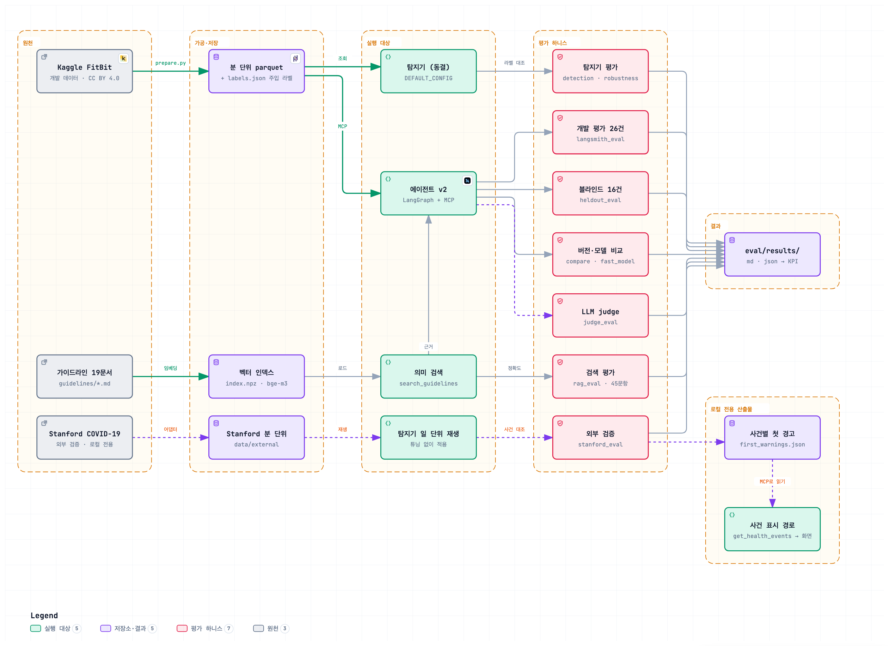

```bash
.venv/bin/python -m eval.detection_eval          # 탐지기: 재현율, 정밀도 근사, 깨끗한 데이터 알림 부담
.venv/bin/python -m eval.robustness_benchmark    # 강건성 몬테카를로 (튜닝 시드 / 홀드아웃 시드 분리)
.venv/bin/python -m eval.langsmith_eval --offline   # 에이전트 종단 평가 26건 (LangSmith 없이, LLM ON, 건당 수십 초)
.venv/bin/python -m eval.langsmith_eval             # 같은 평가를 LangSmith Dataset/evaluate()로 (API 키 필요)
VARIANT=v0 .venv/bin/python -m eval.latency_bench > eval/results/latency_v0.json
.venv/bin/python -m eval.heldout_eval --out-suffix _rerun   # 블라인드 홀드아웃 16건 (첫 실행만 블라인드)
```

LangSmith 실험(비공개): 개발 평가 26건, 블라인드 홀드아웃 첫 실행, 홀드아웃 최종 재실행.

에이전트 종단 평가는 `langsmith_eval.py`(9지표)이고 블라인드 홀드아웃 `heldout_eval.py`가 더해진다.

### 현재 결과

핵심 수치는 위 KPI 표에 있다. 아래는 KPI 표에 넣지 않은 보조 결과다 (앞의 에이전트 평가와 같은 코드 기준).

| 지표 | 값 | 출처 | 해석 주의 |
|---|---|---|---|
| 정밀도 근사 | 0.528 (유형까지 일치 0.389) | `detection_eval.md` | 주입 사용자 탐지 36건 중 주입 구간과 겹친 비율. 나머지는 실제 데이터의 자연 알림과 주입의 부수 효과. 이 파일은 극단 규칙 추가 전 실행이다 |
| 강건성 벤치마크 | 410표본, 홀드아웃 시드 20261020, 튜닝 시드 101~103 | `robustness_benchmark.md` | 튜닝 시드로 구성(C_combined)을 고르고 홀드아웃 결과만 보고 |
| 지연 최적화 | 기준선 평균 71.1초에서 채택안 v5 31.5초 (5건, 측정 당시 fast `qwen2.5:3b`에 analysis도 fast. 현재 기본값은 analysis 8b로 약 10~15초 더 느리다). 최종 개발 평가 26건의 전체 p50 23.4초 | `eval/results/latency.md` | 5건 단일 실행이라 방향성 확인이다. 공유 Ollama 때문에 편차가 크다 |
| 블라인드 홀드아웃 | 첫 실행 14/16 (측정 당시 fast `qwen2.5:3b`), 수정 뒤 재실행 16/16, 15/16, 15/16, 최종 15/16 | `heldout_eval*.md` | 첫 실행만 블라인드. 15/16 세 번은 H09(데이터 부족 고지 문구 키워드)가 실패하며 채점기 키워드 한계다 |

### 외부 검증 (Stanford COVID-19 웨어러블)

동결한 탐지기를 실제 질병 사건이 있는 외부 데이터에 튜닝 없이 처음 적용했다. 데이터와 라이선스는 [데이터](#데이터) 절, 전체 표는 [모델 벤치마크 #7](#모델-벤치마크)과 `eval/results/external_stanford.md`에 있다.

- COVID-19 사건 민감도는 27/32(84%)이지만 우연 기대가 20.8/32(65%)이고 창 안 알람일 비율은 사건 밖의 약 1.3배(0.251 대 0.189)다. 관찰된 적중의 약 77%는 우연한 겹침으로 설명되므로 **약한 신호**다.
- 기타 질병은 7/13(54%)로 우연 기대(72%)에 못 미쳤다.
- 진단일 기준 민감도는 26/31(84%), 선행 일수 중앙값은 증상일 기준 3일·진단일 기준 4일이다. 유형별로는 추세 8/32(25%), 개인 기준 이탈 14/32(44%), 휴식 빈맥 15/32(47%)다.
- 건강 대조군의 알람일은 사람-30일당 3.74일(평가일의 약 12%)이고 대부분 휴식 빈맥(3.36)이다. 서비스 알림으로 쓰기에는 외부 데이터의 거짓 경보가 많다.
- 논문 참고값(SuppTable13, RHR-Diff 오프라인)은 COVID-19 26/30(0.867), 기타 질병 13/14(0.929)이지만 방법과 창 정의가 달라 직접 비교하지 않는다.
- 이 평가는 한계가 많은 외부 시험이다: 사건 수가 적고 수면 정보가 일부 참가자에게만 있으며 논문의 오프라인 방법과 조건이 다르고 탐지기는 질병 탐지용으로 튜닝되지 않았다. 점수를 매기는 시험이 아니고 개발 데이터 밖에서 신호가 얼마나 남는지 보는 용도다.

## 보안

비밀값(API 키, 토큰)이 저장소에 들어가지 않게 gitleaks로 막는다.

| 파일 | 역할 |
|---|---|
| `.gitleaks.toml` | 기본 규칙셋 사용. 공개 원천 데이터(`data/raw/`)와 `node_modules`, 빌드 산출물만 검사에서 제외 |
| `.pre-commit-config.yaml` | pre-commit 프레임워크용 훅 (gitleaks v8.30.1) |
| `scripts/install-hooks.sh` | 프레임워크 없이 로컬 gitleaks 바이너리로 `.git/hooks/pre-commit` 설치. 가짜 토큰으로 커밋이 차단되는 것을 확인했다 |
| `.env.example` | 환경변수 견본. 실제 `.env`는 `.gitignore` 대상이다 |

```bash
brew install gitleaks && scripts/install-hooks.sh   # 커밋 훅 설치
gitleaks git . --redact                             # 전체 커밋 이력 검사
gitleaks dir . --redact                             # 작업 트리 검사
```

2026-10-20 05:50 기준 커밋 이력과 작업 트리 검사에서 유출은 발견되지 않았다 (gitleaks 8.30.1).
API 키 같은 비밀값 말고도 알아 둘 보안 한계가 있다. 이 서버는 **인증·인가가 없다.** 누구나 모든 사용자의 데이터를 읽을 수 있고 `thread_id`를 아는 사람은 그 대화를 이어갈 수 있으므로 `127.0.0.1`로만 띄우고 외부에 노출하지 않는다.
LangSmith 키 같은 값은 `.env`에만 두고 코드, 문서, 평가 결과 파일에 쓰지 않는다.

### 컨테이너 하드닝

`docker compose`로 띄우는 구성에 아래 보안 설정을 넣었다 (`Dockerfile`, `frontend/Dockerfile`, `docker-compose.yml`, `frontend/nginx.conf.template`).

| 항목 | 내용 |
|---|---|
| 이미지 고정 | 베이스 이미지(`python:3.11-slim`, `node:22-alpine`, `nginx-unprivileged:1.27-alpine`)를 태그와 digest(`@sha256:...`)로 함께 고정한다. 같은 태그가 나중에 다른 내용을 가리켜도 빌드가 바뀌지 않는다. digest가 빠지면 `tests/test_packaging.py`가 잡는다 |
| 실행 사용자가 코드 파일을 수정할 수 없음 | 백엔드 코드와 가공 데이터는 root 소유에 쓰기 금지(`go-w`)로 두고 실행 사용자(uid 10001, 로그인 셸 없음)는 바꿀 수 없다. 쓸 수 있는 곳은 `/app/state`(대화 기억 sqlite)와 `/app/data/processed/rag`(임베딩 캐시) 두 곳뿐이다 |
| 권한 최소화 | 두 컨테이너 모두 `cap_drop: ALL`, `no-new-privileges:true`. 프론트엔드는 비루트 nginx(`nginx-unprivileged`)다 |
| 포트 | 백엔드 8100, 프론트엔드 8600은 `127.0.0.1`에만 연다. 인증이 없는 서버라 LAN에 노출하지 않는다 |
| nginx | `server_tokens off`(버전 노출 차단)와 보안 헤더 조각을 적용하고 `/api`만 백엔드로 프록시한다 |
| Ollama | LAN에 노출하지 않는다. 호스트 Ollama를 `0.0.0.0`으로 열라고 권하지 않고, 컨테이너 Ollama(`--profile ollama`)도 호스트 포트를 열지 않는다 |
| 과금 확인 | OpenAI 백엔드는 `OPENAI_CONFIRM=yes`가 없으면 시작하지 않고, 스크립트가 y/N을 받은 뒤 그 프로세스에서만 켠다 (`.env`의 값은 무시) |

한계: 백엔드와 nginx의 루트 파일시스템은 읽기 전용으로 두지 않았다(nginx는 기동 때 설정 파일을 써야 하고 백엔드는 쓰기 가능한 경로가 둘 있다). 의존성 스캔(npm audit, pip-audit)은 0건이고 컨테이너 이미지 스캔(trivy 등)은 하지 않았다.

### 의존성 취약점 스캔

2026-10-20 12:25 (KST)에 알려진 취약점 데이터베이스로 의존성을 검사했다.

| 대상 | 명령 | 결과 |
|---|---|---|
| 프론트엔드 (운영 의존성) | `cd frontend && npm audit --omit=dev` | 취약점 0건 |
| E2E (Playwright) | `cd e2e && npm audit` | 취약점 0건 |
| 백엔드 (Python) | `uvx pip-audit -r requirements.txt` | No known vulnerabilities found |

범위: 직접·간접 의존성의 알려진 취약점만 본다. 컨테이너 이미지(OS 패키지 포함) 스캔은 하지 않았다. 새 패키지를 추가하거나 이미지 digest를 갱신할 때 다시 돌리는 것을 권한다.

## 품질 보증

개발자 자체 테스트와 별도로 세 가지 절차를 돌렸다.

| 절차 | 내용 | 결과 |
|---|---|---|
| 코드 점검 | 작성 과정과 분리해 `app/`과 `frontend/src`를 읽고 가능한 항목은 스크립트로 재현 | 19건 (HIGH 5, MEDIUM 7, LOW 7). HIGH 5건은 모두 수정 |
| 안전 문장 우회 시험 | 안심·진료 미루기 문장을 새로 만들어 이상 있는 리포트와 이상 없는 리포트의 모든 경로(스트리밍 포함)에 넣어 본다. 문구 사전 방식이 새 표현에 뚫려 허용 목록 방식으로 바꾼 뒤 반복했다 | 이전 시험 문장 73개는 모두, 새로 만든 HIGH 등급 시험 문장 26개 중 24개가 모든 경로와 스트리밍에서 차단됐다. 남은 2개는 이상이 없을 때의 평서문 안심 표현이며 고정 안내(`NO_ANOMALY_GUIDANCE`)가 모든 답변에 붙어 완화한다. 실제 탐지 데이터의 사실 문장은 10/10이 유지된다. 잔여는 한계에 적었다 |
| 회귀 시험 | API E2E, Playwright E2E, 탐색적 질의(프롬프트 인젝션 포함). 발견한 버그는 수정한 뒤 같은 시나리오로 다시 확인 | 낮은 심각도의 남은 관찰은 한계에 적었다 |
| 블라인드 홀드아웃 | 에이전트 코드를 보지 않고 만든 16건. 라벨은 데이터와 탐지기 출력에서 유도하고 채점 규칙은 실행 전 고정 | 첫 실행 14/16. 개발 평가셋이 거의 만점일 때 나온 수치다. 최종 재실행은 15/16(블라인드 아님) |

코드 점검 HIGH 5건은 에스컬레이션 플래그 유실, 탐지 실패의 거짓 "이상 없음", 진단 단정 규칙 우회, 조사가 붙은 사용자 ID 미인식, 후속 질문이 다른 사용자의 사실을 쓰는 문제다.
블라인드 평가는 한 번만 블라인드로 성립하므로 수정 뒤 재실행은 회귀 확인용으로만 쓴다.
확인하지 못한 항목: LLM 스트림 중 클라이언트 이탈이 Ollama의 생성 중단으로 이어지는지는 공유 Ollama 때문에 판정하지 못했다.

## 설계 결정

- **탐지는 결정론적 코드, 해석은 LLM**: 같은 입력이면 같은 결과라 재현·평가가 가능하고 LLM이 이상을 지어내지 못한다. 라우팅과 계획에도 LLM을 쓰지만 코드 게이트가 보정한다.
- **안전(권위) 게이트**: 소형 LLM에 "위험하면 119를 안내하라"고 시켜도 빠뜨릴 수 있어서 critical 안내는 코드가 확정한다. 에스컬레이션은 저장하지 않고 이상 목록에서 매번 다시 계산한다.
- **전용 Validator**: 근거 없는 수치, 진단·복약 단정, 단정적 안심을 규칙으로 잡는다. 실패하면 한 번 다시 쓰게 하고 그래도 실패하면 템플릿 리포트로 대체한다.
- **4계층 오류 처리**: 재시도, 도구 실패 격리, 규칙 폴백, 템플릿 리포트 순으로 내려가 LLM이 없어도 끝까지 동작한다.
- **로컬 LLM(Ollama)과 데이터 최소화**: 건강 데이터를 외부로 보내지 않기 위해 로컬 모델을 기본으로 쓰고 가명 ID와 집계 사실만 LLM에 전달한다.
- **가이드라인 의미 검색과 MCP 서버 분리**: 정적 안전 문서(Resource)와 검색(Tool)을 별도 서버로 나눠 한쪽이 죽어도 나머지가 동작한다.
- **보호자 알림은 사람 승인(HITL)**: 되돌릴 수 없는 외부 행동이라 `interrupt`로 멈추고 승인을 받는다. 안내문은 승인과 무관하게 이미 리포트에 있다.
- **여러 사용자 비교는 최대 3명**: 사용자별 사실을 나란히 설명하는 것이고 통계적 비교나 우열 판정이 아니다.
- **이상 리포트는 사실 서술만 허용(허용 목록)**: 금지 문구 사전은 새 표현에 계속 뚫려서 방향을 뒤집었다. 사실을 서술하는 문장만 남기고 조언·평가·안심은 코드가 쓴다.

## 개발 가이드

- **커밋 전에 테스트**: `.venv/bin/python -m pytest -q`와 `cd frontend && npm test && npm run build`가 통과해야 한다. 새 동작에는 LLM 없는 결정론적 테스트(`tests/fakes.py`의 fake, `LLM_ENABLED=false`)를 추가한다.
- **Python**: 3.11, 타입 힌트, 패키지는 `uv pip install --python .venv/bin/python <pkg>` 후 `requirements.txt`에 버전 고정. 린트는 ruff를 쓰며 별도 설정 파일은 없다. 주석과 docstring은 한국어로, 임계값에는 근거를 주석으로 남긴다.
- **구조 규율**: 탐지(`app/detection`)에 LLM을 넣지 않는다. 노드는 `ToolBox`/`LLM`을 생성자로 주입받는다. 숫자는 tool 결과에서만 인용하고 면책·안내문은 코드가 조립한다.
- **MCP Tool**: docstring에 인자 의미·단위·반환 필드·실패 형식(`{"error": ...}`)을 정확히 쓴다. 정적 문서는 Resource로 둔다.
- **SSE 이벤트 변경**: `app/agent/events.py`와 `frontend/src/events.ts`를 함께 고치고 `test_event_models_match_contract`를 통과시킨다.
- **커밋 메시지**: `영역: 변경 요약` 형식(예: `frontend: token.reset 처리`). 비밀값(`.env`, Kaggle 키)과 데이터(`data/raw`, parquet)는 커밋하지 않는다.

## 한계와 로드맵

- **의료기기가 아니다.** 임계값은 일반 가이드라인 수준의 보수적 기준이며 임상 검증을 거치지 않았다. 리포트는 진단하지 않고 진료 상담을 권고하는 수준에 머문다.
- **평가 라벨이 합성이다.** 이상 이벤트는 실데이터 위에 우리가 주입한 것이라 재현율은 낙관적이다. 실제 임상 이벤트에 대한 성능은 알 수 없다.
  깨끗한 데이터의 알림(거짓 경보 근사)은 정답 라벨이 없다. 홀드아웃 시드 분리는 튜닝 편향을 줄일 뿐 외부 타당성을 만들지 않는다.
- **데이터가 작고 오래됐다.** 사용자 15명, 2016-03~05 약 6주, 분 단위 커버리지는 사용자별 1%~95%로 편차가 크다 (2명은 5일 이하). 사용자 간 일반화를 주장하지 않는다.
- **걸음으로 잡히지 않는 활동**(자전거, 근력 등)이나 카페인·스트레스성 상승은 안정 시 빈맥으로 오탐될 수 있다. 실제 데이터의 일부 critical 알림이 이런 경우일 가능성이 있다 (예: U04).
- **소형 로컬 LLM의 한계.** (측정 당시 fast는 `qwen2.5:3b`. 현재 기본 `qwen3:0.6b`의 route 정확도는 같은 40건에서 1.0이었다.) 3b 라우터는 후속 질문을 analysis로 오분류하는 경우가 있어 후속 질문 판정은 코드 규칙으로 강제한다. 이 규칙은 행위 키워드 없이 새 점검을 뜻하는 말을 후속 질문으로 오판할 수 있다. 규칙으로 막는 것은 형태가 정해진 위반뿐이라 8b 서술의 의미 오류는 일부만 잡힌다.
  규칙을 조일수록 템플릿 대체가 늘어난다. 중간 개발 평가에서 검증기 1차 통과율이 목표(90%)에 못 미쳤다가 이후 수정으로 0.923이 됐다.
  실제 LLM 실행에서 U05 분석이 지어낸 숫자로 검증에 두 번 걸려 템플릿으로 대체됐다(81초). 안전한 실패지만 느리다.
  기록이 부족한 사용자(U02)의 리포트는 고정 안내문 아래에 "임계값을 넘는 구간이 감지되지 않았습니다"를 여러 번 되풀이해 안심 표현처럼 읽힐 수 있다 (사실 문장이라 차단하지 않음).
- **안전을 위해 해석 깊이를 줄였다 (허용 목록의 대가).** 안심·돌봄 축소 표현을 문구 사전으로 막는 방식은 우회 문장 시험에서 새 표현에 뚫렸다(후속 질문 15/16, 분석 경로 5/5). 그래서 이상이 있는 리포트에서는 LLM 본문에서 사실을 서술하는 문장만 남기고 조언·평가·안심·진료 문장은 지운 뒤 대응 안내(에스컬레이션 안내문, 경고용 고정 문구, 데이터 한계 안내)를 코드가 쓴다. 문장이 사실로 인정되려면 모든 어절이 고정 사실 어휘나 이번 분석의 FACTS 단어여야 한다(닫힌 어휘 검사). 진료·응급 부정, 증상 넘기기, 운동·음주 허가는 이상이 없는 리포트를 포함한 모든 경로에서 막는다. 저장된 v2 이상 리포트 33건에 오프라인으로 적용하면 글자 평균 47%(12~77%), 문장 134/369개(0.36)가 남고 빈 리포트는 0건이다(저장 결과에 FACTS가 없어 하한에 가깝다). 지워지는 것은 주로 해석·권고 문단이라 이상 리포트는 거의 사실과 고정 안내만 남는다. 탐지기가 쓰는 문구와 리포트 템플릿의 단어는 허용 어휘에 자동으로 들어가고 이상이 없는 리포트와 일반 답변에는 코드가 고정 안내를 붙인다. 어휘 목록과 판정 규칙이 휴리스틱이라 사실 문장을 지울 수 있고 허락·미루기 일반 패턴("~셔도 됩니다", "괜찮", "그냥 두세요")과 운동·음주 허가도 모든 경로에서 막는다. 남은 잔여는 셋이다. 고정 어휘만으로 짠 맥락 문장("활동 이후 기록된 값")은 통과할 수 있고 탐지기 근거 문장을 다른 사건에 옮겨 붙인 문장도 통과할 수 있다(복사 비율로 가르면 정당한 문장까지 지워져 채택하지 않았고 에스컬레이션 띠와 고정 안내는 남는다). 이상이 없는 본문의 보호적 조언은 지워지고 고정 안내가 대신한다. 최종 규칙은 이렇다. 모든 LLM 경로와 스트리밍에서 명령·권유 서술어가 든 문장(인사 "안녕하세요"만 예외), 예측·안심 서술어(거예요, 겁니다, 것입니다, 테니)가 든 문장, 양보·허가형(-셔도, -어도 등)이 든 문장을 예외 없이 지운다. 조언과 예측은 코드만 쓴다. 대가로 무해한 생활 조언("물을 충분히 마시세요")도 지워져서 시험 표본에서 이상 없는 답변의 무해한 LLM 문장 13개 중 4개만 남았다. 우회 문장 시험에서 남은 것은 이상이 없을 때의 평서문 안심 표현 2건이다(고정 안내가 완화한다). 측정은 [`eval/results/allowlist_cost.md`](eval/results/allowlist_cost.md)이고 이상 리포트를 텍스트로 골라 선택은 근사다. 실제 LLM 평가는 다시 돌리지 않았다.
- **진단 표현 검증기의 잔여 우회.** 우회 문장 시험에서 새 문장 18개 중 17개, 헤지 악용 9개 중 8개를 막았다. "심장마비가 왔습니다", "의심의 여지 없이 부정맥입니다"는 아직 통과하고 "고혈압 약을 드시는 분은…" 같은 일반 안내가 오탐돼 재작성 1회를 유발한다.
- **인증이 없다.** 로컬 데모 전제이며 공개 배포용이 아니다.
- **보호자 알림은 시뮬레이션이다.** 승인 단계(HITL)는 있지만 실제 전송 채널, 수신자 등록, 감사 로그는 없다. 인증이 없어서 `thread_id`를 아는 사람은 승인 요청을 보낼 수 있다.
- **사용자 비교는 최대 3명이다.** 비교는 사용자별 사실을 한 리포트에 나란히 설명하는 것이고 통계적 비교나 우열 판정이 아니다.
- **외부 데이터에서 신호가 약하다.** Stanford COVID-19 데이터에서 사건 민감도는 우연 기대를 1.3배 정도 넘고 건강 대조군에서도 알람일이 평가일의 약 12%다. 탐지기는 질병 조기 탐지용이 아니다 (평가 절 참고). 화면의 "증상 N일 전 첫 경고" 표시도 평가와 같은 정의(증상 시작일 -7~+3일 창의 첫 알람)로 맞췄고 평가에 든 COVID-19 증상 시작 32건 중 시작 전 경고는 16건, 당일 3건, 시작 후 8건, 창 안 경고 없음 5건이다(시작 전과 당일 19건은 평가 결과와 같다).
- **Ollama 연결 끊김 시 생성 중단은 확인하지 못했다.** 클라이언트가 이탈하면 그래프 태스크는 취소되지만 Ollama의 생성이 멈추는지는 공유 Ollama 때문에 검증하지 못했다.
- **걸음이 0인 운동은 휴식으로 보인다.** 자전거나 근력 운동은 걸음이 기록되지 않아 일반 빈맥 규칙에서 운동 억제가 작동하지 않는다. 극단 규칙(180 bpm 이상 10분)만 잡는다.
- **극단 심박 규칙은 알림 시작 직전 15분의 보행만 본다.** 알림 구간 자체의 보행은 보지 않으므로 운동이 막 시작되는 구간의 급한 상승은 해제 조건이 맞으면 critical이 된다 (홀드아웃 `exercise-320`: 알림 구간의 분당 걸음 34).
- **상태 표시줄의 "기록된 시간"은 리포트의 커버리지와 다를 수 있다.** 프론트가 리샘플한 시계열에서 계산하고 리포트는 분 단위 커버리지를 쓰기 때문이다 (예: U02는 2.3%와 1.4%).
- **개인 기준 이탈 탐지가 약하다.** 홀드아웃 재현율 0.77로 목표 0.90에 못 미치고 경계 표본 탐지율은 0.06이다 (KPI 표).
- **RAG는 Ollama와 임베딩 모델에 의존한다.** 꺼져 있으면 키워드 검색으로 내려가고 정확도가 떨어진다 (hit@1 0.444, hit@3 0.756). 질의마다 임베딩 호출이 들어가 키워드보다 약 22배 느리다(50.61 ms 대 2.29 ms, LLM 생성 수 초에 비하면 작다).
  검색 평가 질문 45개는 코퍼스를 쓴 사람이 만들어 낙관적이고 검색이 답변 품질로 이어지는지는 재지 않았다. 코퍼스는 직접 쓴 일반 상식 수준의 요약이고 특정 기관 문서와 대조하지 않았으며 일부 수치는 대략적인 값이다. 의학적 조언이 아니고 의료진의 검토를 받지 않았다 ([NOTICE.md](NOTICE.md)).
- **평가의 공백.** 서술 품질을 재는 LLM judge(`eval/judge_eval.py`, 평가 전용, 로컬 `qwen3:8b`)는 리포트 42건에서 점수가 4.9~5.0으로 거의 만점이라 변별력이 낮다. 주입한 수치 오류는 정확 일치가 17/20, judge가 4/20만 잡아 judge는 정확 일치를 대체하지 못한다 (`eval/results/judge_eval.md`). 개발 평가 26건은 회귀 신호용이며 블라인드 홀드아웃 16건도 95% 구간이 넓어 통계적 비교에는 작다.
- **운영 요건 미충족.** 동시 부하 시험 없음, MCP 세션 공유(서버별 1개), 자동 재기동 없음, SSE heartbeat 없음, postgres checkpointer 미검증, 입력 PII 필터·보존 정책 없음.
  LangSmith 트레이싱을 켜면 집계 사실과 질문·리포트가 마스킹 없이 그대로 외부로 전송된다. 인증도 없다.

### 로드맵

- 개인 기준 이탈 탐지를 보강하고 경계 표본 탐지율을 올린다.
- 행위 키워드가 없는 새 점검 요구의 판별을 보강한다.
- 큰 모델 judge 또는 사람 검수 샘플로 서술 품질 평가를 추가한다.
- 임상 라벨 데이터로 외부 검증을 한다.
- 인증과 사용자-스레드 결속을 넣고 동시 부하·postgres checkpointer를 검증한다.

## 데이터와 라이선스

- **출처와 라이선스 전체 목록은 [NOTICE.md](NOTICE.md)에 있다** (FitBit, Stanford, 가이드라인 문서, 모델, 연구 방법, 로고).
- **데이터**: 출처, 라이선스, 컬럼 사전, 전처리는 위 [데이터](#데이터) 절에 있다. FitBit은 원본 Zenodo(Furberg 외, CC BY 4.0)를 Kaggle [`arashnic/fitbit`](https://www.kaggle.com/datasets/arashnic/fitbit)에서 받은 것으로, 원본의 CC BY 4.0에 맞춰 원저자와 변경 사항을 밝히고 가공본을 저장소에 포함한다. Stanford COVID-19 웨어러블은 라이선스 표기가 없어 저장소에 넣지 않는다.
  평가용 이상은 FitBit 실데이터 위에 합성 주입한 것이다. 원본 사용자 ID는 `U01`..`U15`로 가명화해 노출한다 (매핑은 `data/processed/id_map.json`).
- **코드 라이선스**: [MIT](LICENSE) (Copyright (c) 2026 kimddong23). 소스 코드와 문서에 적용된다. 데이터, 모델 같은 제3자 자료는 각자의 라이선스를 그대로 따른다.
- **가공 데이터(`data/processed/`)**: CC BY 4.0 데이터셋의 2차 저작물이라 MIT가 아닌 CC BY 4.0의 조건(원저자 표시, 변경 사항 표시)을 유지한다. 표시는 [NOTICE.md](NOTICE.md)와 `data/README.md`에 있다.

## 감사의 말

- 연구 참고: Mishra et al., 2020 (*Nat. Biomed. Eng.*, 웨어러블 안정시 심박 기반 조기 이상 탐지). 공개 코드 `gireeshkbogu/AnomalyDetect`(MIT)의 RHR-AD·HROS-AD 계열(시간 단위 EllipticEnvelope)을 `app/detection/research.py`에 선택적으로 다시 구현했다. 논문의 RHR-Diff는 구현하지 않았다.
  Alavi et al., 2022 (*Nat. Med.*, 웨어러블 실시간 알림; CuSum 계열이라고 알려져 있으나 공개 소스를 찾지 못해 표준 단측 CuSum을 직접 구현했고 논문 파라미터를 재현한 것이 아니다).
- 데이터: FitBit 데이터 제공자(Furberg 외), Kaggle 재배포자(`arashnic`), Stanford COVID-19 웨어러블 연구진(Mishra 외).

## 면책

Vital Sentinel은 **의료기기가 아니며** 질병을 진단·치료·예방하지 않는다. 출력은 웨어러블 심박 데이터에 대한 참고용 분석이다.
탐지 임계값은 일반 가이드라인 수준의 보수적 기준이고 임상 검증을 거치지 않았으며 평가 라벨은 합성이다. 증상이 있거나 걱정되면 의료진과 상담하고 응급 증상이 있으면 즉시 119에 연락한다.
