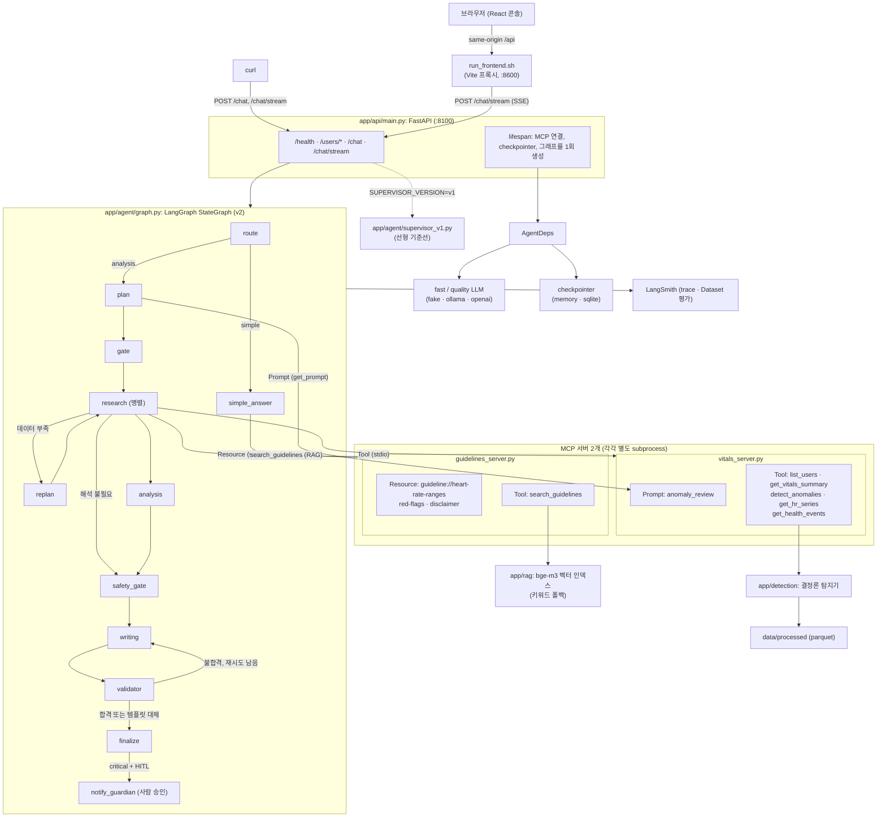
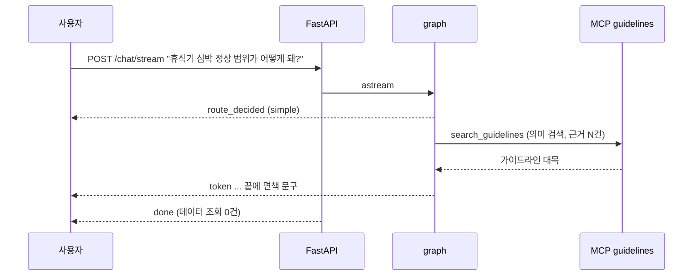
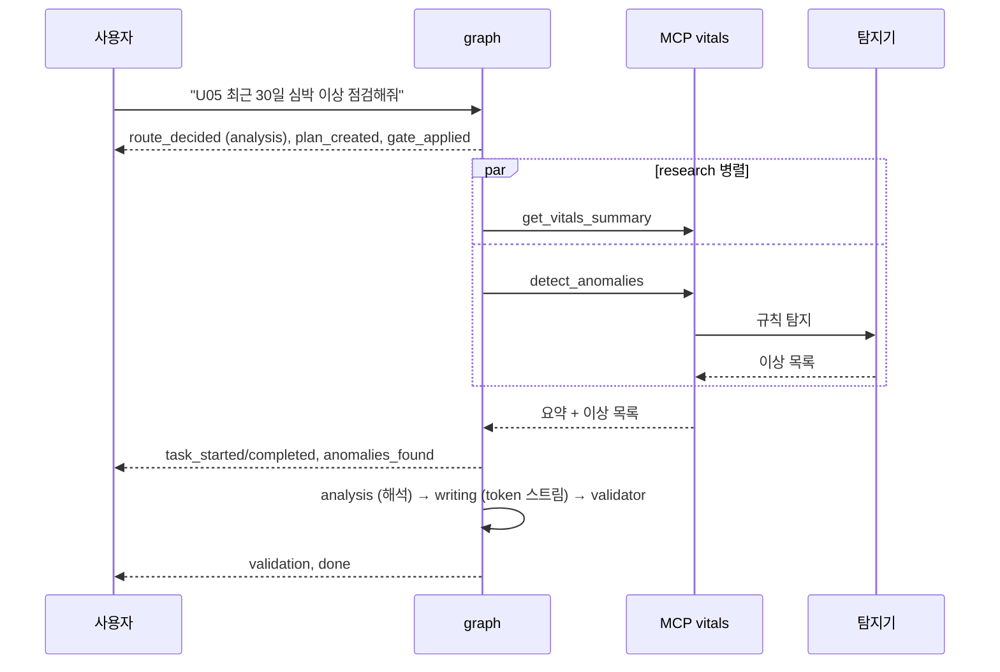
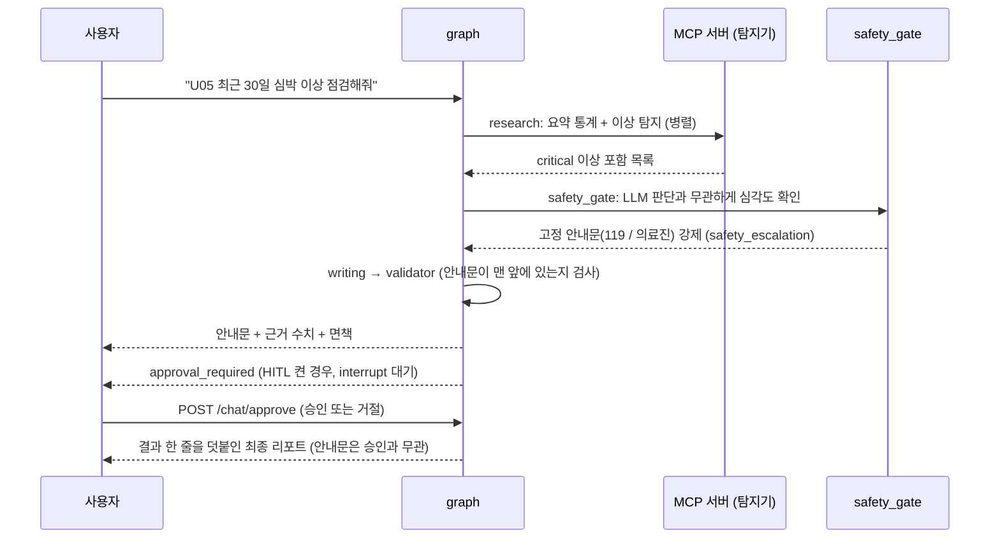
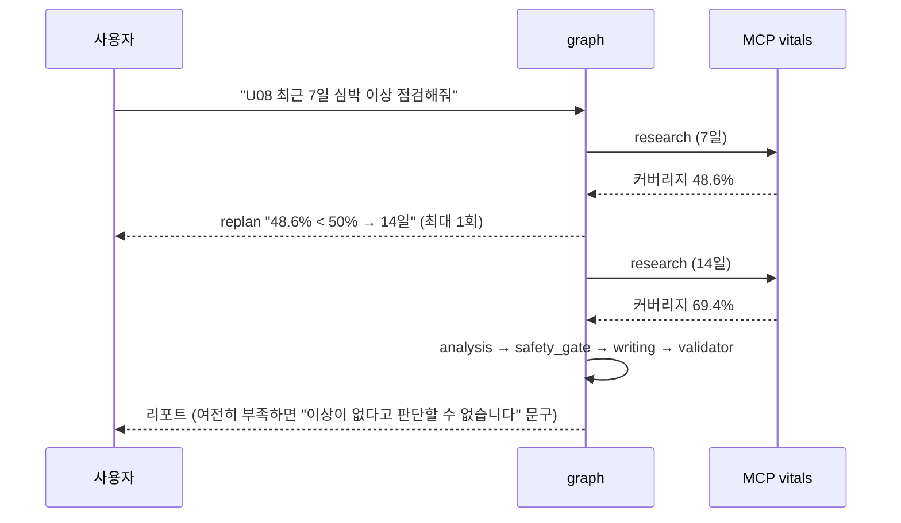
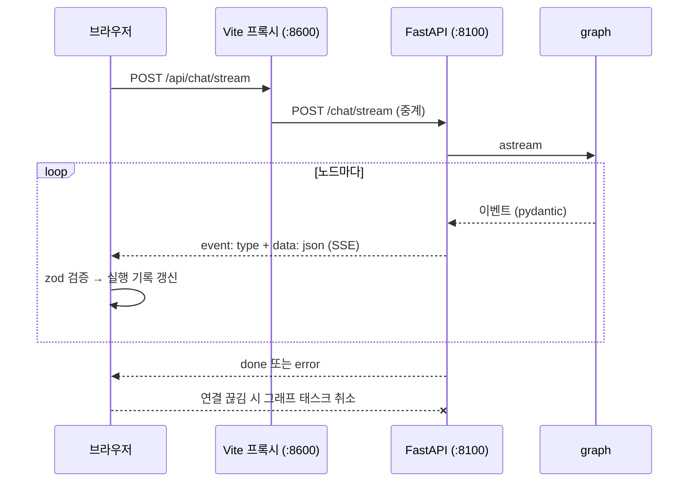
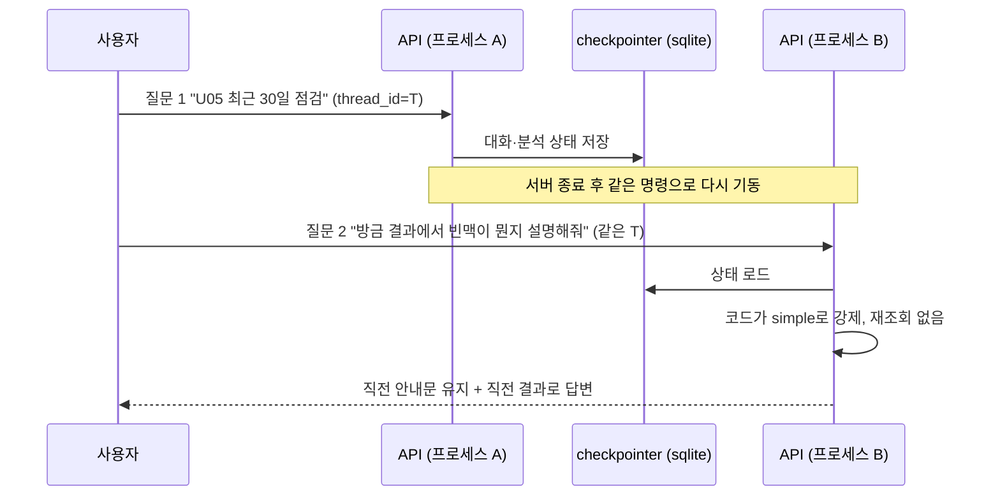

# 아키텍처와 구조

시스템 구성도, 에이전트 그래프, 유스케이스별 흐름, 소스 디렉터리 구조와 주요 기능의 상세를 모았다. 개요는 [README](../README.md)에 있다.

## 기능 상세

- **결정론적 이상 탐지**: 5개 유형(`resting_tachycardia`, `bradycardia`, `personal_deviation`, `elevated_resting_trend`, `sensor_gap`)을 LLM 없이 규칙과 통계로 탐지한다. 운동 중·직후 심박 상승은 이상으로 치지 않되 활동으로 설명되지 않는 극단값(210 bpm 이상 등)은 안정 시 빈맥의 극단 빈맥 규칙(`method="extreme"`)이 critical로 올린다. (→ 유스케이스 2)
- **LangGraph 에이전트**: 질문 라우팅(단순 답변 대 분석), 계획과 이중 게이트, 병렬 조회, 데이터 부족 시 1회 재계획, 해석, 서술, 검증, 보호자 알림 승인(HITL)을 12개 노드로 실행한다. 같은 대화의 후속 질문은 코드가 재분석을 막고 이전 결과로 답한다. "U01이랑 U05 비교해줘"처럼 사용자를 여럿 말하면 최대 3명을 병렬로 조회하고 안전 게이트를 사용자별로 돈다. (→ 유스케이스 2, 4, 6)
- **안전(권위) 게이트**: critical 이상이 있으면 LLM 판단과 무관하게 고정 안내문(119/의료진)을 리포트 맨 앞에 강제한다. 에스컬레이션은 저장하지 않고 이상 목록에서 매번 도출하며 탐지 실패를 "이상 없음"으로 쓰지 않는다. (→ 유스케이스 3)
- **Human-in-the-loop 승인**: critical 이상이 있고 `HITL_ENABLED`이면(제공 스크립트·compose 기본값에서는 켜져 있고 설정 기본값은 꺼짐) 보호자 알림(시뮬레이션) 발송 전에 `interrupt`로 멈추고 `POST /chat/approve`의 승인 또는 거절을 기다린다. 안내문은 승인과 무관하게 이미 리포트에 있다. 실제 전송 채널은 없다. (→ 유스케이스 3)
- **Validator**: 근거 없는 수치, 절 단위 진단·복약 단정(한국어와 영어), 단정적 안심 표현, 거짓 "이상 없음", 필수 문구 누락을 규칙으로 검사하고 1회 재작성한다. 소진되면 템플릿 리포트로 대체한다. 스트리밍 문장 가드가 위반 문장을 화면에 내보내지 않는다. 이상이 있는 리포트에서는 LLM 본문에서 사실 서술(닫힌 어휘 검사 통과)만 남기고 조언·평가·안심·진료 문장은 지운 뒤 대응 안내를 코드가 쓴다 (허용 목록). (→ 유스케이스 3)
- **MCP 서버 2개**: `vitals`(Tool 5개: 사용자·요약·탐지·시계열·연구 사건 라벨, Prompt 1개)와 `guidelines`(Resource 3개, 의미 검색 Tool `search_guidelines`)를 stdio subprocess로 띄운다. (→ 유스케이스 2)
- **RAG(가이드라인 의미 검색)**: 가이드라인 19개 문서(52청크)를 bge-m3로 임베딩해 질문과 가까운 대목을 찾는다. Ollama가 닿지 않거나 LLM을 끄면 임베딩을 부르지 않고 키워드 검색으로 내려가며 질의 임베딩은 3초 상한이고 인덱스는 백그라운드에서 만든다. (→ 유스케이스 1)
- **실시간 SSE**: 라우팅, 계획, 게이트, 재계획, 이상 목록, 안전 에스컬레이션, 토큰, 검증 결과를 이벤트로 스트리밍하고 프론트가 단계별 실행 기록으로 보여준다. (→ 유스케이스 5)
- **LLM 교체와 장애 내성**: `LLM_BACKEND`로 `fake`(LLM 없음), `ollama`(로컬), `openai`(과금)를 바꿔 꽂는다. LLM이 없거나 죽어도 키워드 라우팅, 규칙 계획, 템플릿 리포트로 끝까지 동작한다. (→ 유스케이스 2)
- **Before/After 비교용 v1**: `SUPERVISOR_VERSION=v1`은 라우팅·게이트·안전 게이트·검증이 없는 선형 기준선이다 (비교 수치는 [KPI와 Before/After](evaluation.md#kpi와-beforeafter)).
- **개인정보 최소화**: 가명 ID, LLM에는 집계 사실만 전달, 로컬 LLM(Ollama) 기본 사용.
- **대화 기억과 요약**: checkpointer가 `thread_id`별 상태를 저장하고 같은 대화에서 말한 이름·나이는 되물으면 코드가 기록에서 답하며(제공 스크립트·compose 기본값인 sqlite에서는 서버를 재시작해도 유지, 설정 기본값은 memory), 미요약 메시지가 10개를 넘으면 오래된 대화를 fast LLM으로 요약해 컨텍스트 상한을 지킨다 (`SUMMARIZE_AFTER_MESSAGES`). (→ 유스케이스 6)
- **재현 가능한 평가**: 실데이터 위에 이상을 주입해 라벨을 만들고 튜닝 시드와 홀드아웃 시드를 분리하며 코드를 보지 않고 만든 블라인드 홀드아웃으로 일반화를 점검한다. (→ [사용자 가이드](manual_ollma.md)의 운영자용 절)

## 아키텍처 구성도


아래는 같은 구조의 텍스트 대체본(mermaid)이다.



- **싱글턴**: MCP 연결, checkpointer, 컴파일된 그래프를 `lifespan`에서 한 번만 만들어 `app.state`에 둔다. 요청마다 subprocess를 띄우지 않는다.
- **의존성 주입**: 노드는 `AgentDeps`(도구, LLM, checkpointer, 버전)를 받아 동작한다. 테스트는 fake를 꽂아 LLM 없이 결정론적으로 돈다.
- **백엔드 교체**: `LLM_BACKEND=fake|ollama|openai`로 그래프 코드를 바꾸지 않고 LLM을 갈아 끼운다. LLM이 죽어도 키워드 라우팅과 템플릿 리포트로 끝까지 간다.
- **버전 토글**: `SUPERVISOR_VERSION=v1|v2`. v1은 라우팅·게이트·안전 게이트·검증이 없는 선형 기준선이라 Before/After 비교에만 쓴다. v1로 켜면 화면 위에 경고(빨간 띠)가 뜬다.
- **MCP는 별도 프로세스**: `vitals`(Tool 5, Prompt 1)와 `guidelines`(Resource 3, Tool `search_guidelines`)를 stdio subprocess로 띄우고 클라이언트가 이름으로 찾아 쓴다. 한 서버가 죽어도 나머지는 동작한다. `guidelines`가 죽으면 면책은 코드 상수로, 일반 질문은 번들 요약으로 답하고 `vitals`가 죽으면 조회 태스크가 `task_failed`로 격리되어 리포트가 "이상 탐지를 실행하지 못해 판단할 수 없다"고 밝힌다. `plan` 노드는 Prompt `anomaly_review`를 표준 점검 절차로 가져와 계획에 쓰고 못 가져오면 내장 절차로 계획한다.
- **탐지는 코드, 해석은 LLM**: 이상 구간은 결정론적 규칙이 찾고 LLM은 근거를 풀어 쓰기만 한다.
- **안전 게이트**: critical 이상이 있으면 LLM 판단과 무관하게 코드가 119 안내문을 리포트 맨 앞에 넣는다. `analysis`를 건너뛰어도 `safety_gate`는 반드시 거친다.
- **검증기와 템플릿 대체**: `validator`가 근거 없는 수치, 진단·복약 단정, 단정적 안심을 잡아 1회 재작성시키고 그래도 실패하면 템플릿 리포트로 대체한다.
- **대화 기억**: checkpointer가 `thread_id`별 상태를 저장한다. 후속 질문은 코드가 재분석을 막고 직전 결과로 답한다.

LangGraph 노드 그래프는 `app/agent/graph.py`(v2)와 `supervisor_v1.py`(v1)를 그대로 옮긴 것이다.


### 에이전트 구성 (Supervisor 패턴)

역할이 다른 LLM 에이전트 5개가 시스템 프롬프트와 모델 크기, 출력 형식을 각자 따로 갖고, 다음 단계는 조건부 엣지와 코드 노드 7개가 정한다. 에이전트끼리는 `AgentState`의 칸으로만 주고받는다.

| 에이전트 | 맡는 일 | 모델 | 출력 |
|---|---|---|---|
| `route` | 일반 질문인지 데이터 점검 요청인지 가른다 | fast (`qwen3:0.6b`) | JSON |
| `plan` | 조회할 작업과 기간을 정한다 | fast | JSON |
| `analysis` | 탐지 결과를 시간대와 맥락으로 해석한다 | quality (`qwen3:8b`) | 문장 3개 이내 |
| `writing` | 수치를 인용해 리포트를 쓴다 | quality | 마크다운 리포트 |
| `simple_answer` | 가이드라인과 직전 결과로 일반 질문에 답한다 | quality | 5문장 이내 |

코드 노드는 `gate`(계획 보정), `research`(도구 병렬 실행), `replan`, `safety_gate`, `validator`, `finalize`, `notify_guardian`이다. 에이전트마다 도구를 스스로 골라 반복 호출하는 자율형 구조는 비교해 보고 택하지 않았다. 로컬 소형 모델은 도구 호출이 불안정하고 호출 수와 지연이 늘며, 건강 데이터에서 조회 도구와 기간을 LLM이 마음대로 고르게 두면 위험하다. 그래서 도구 호출은 계획자가 정한 작업 목록을 `research`가 코드로 실행한다.

자세한 그림(PNG와 확대·검색이 되는 인터랙티브 HTML): [시스템 구성도](architecture/system-architecture.html) · [종단 간 흐름](architecture/e2e-system-flow.html) · [노드 그래프](architecture/agent-graph.html) · [저장소 구조](architecture/repo-structure.html) · [데이터와 평가 파이프라인](architecture/data-and-eval-pipeline.html) · [SSE 시퀀스](architecture/sse-sequence.html).

## 주요 유스케이스별 시퀀스 다이어그램

먼저 질문 한 건이 화면에서 시작해 승인 뒤 재개까지 지나가는 종단 간 흐름이다. 점선은 화면으로 가는 SSE 이벤트와 LangSmith로 가는 트레이스다.


번호는 [사용자 가이드](manual_ollma.md)의 사용 예와 같다. 화면 캡처와 "실제로 일어난 일"은 그쪽에 있고 여기서는 흐름만 본다.

### 1. 일반 질문에 바로 답하기



### 2. 사용자 심박 이상 점검



### 3. 위험 수치에서 안내를 코드가 강제하고 보호자 알림은 사람이 승인



### 4. 데이터가 부족하면 기간을 넓혀 다시 조사



### 5. 진행 과정을 실시간으로 보기 (웹 화면)



### 6. 같은 대화에서 이어 묻기 (서버 재시작 뒤에도)



## 소스 디렉터리 구조


화살표는 실제 import 방향이다(에이전트는 MCP 서버를 import하지 않고 stdio로 호출한다). 파일 단위 트리는 아래와 같다.

```text
health_anomaly_agent/
├── README.md                 # 프로젝트 개요
├── requirements.txt          # 버전 고정 의존성
├── .env.example              # 환경변수 견본 (.env 는 커밋하지 않음)
├── .gitleaks.toml            # 비밀값 검사 설정 (pre-commit 훅은 sh/install-hooks.sh)
├── Dockerfile, docker-compose.yml, docker-compose.gpu.yml   # 한 줄 기동 (Ollama 프로필, GPU 선택)
│
├── app/
│   ├── config.py             # 환경변수 → Settings
│   ├── api/main.py           # FastAPI: lifespan 싱글턴, /health·/users/*·/chat·/chat/stream(SSE)
│   ├── agent/
│   │   ├── graph.py          # LangGraph 조립 (노드·조건부 엣지만, v1/v2 선택)
│   │   ├── nodes.py          # 노드 구현 (route … finalize), SSE 이벤트 방출
│   │   ├── gates.py          # 라우팅 폴백·이중 게이트·안전 게이트·재계획 판단 (규칙)
│   │   ├── validator.py      # 리포트 규칙 검증 (근거 수치·진단 단정·안심 표현)
│   │   ├── report.py         # 사실 요약·템플릿 리포트·고정 문구 조립
│   │   ├── deps.py           # AgentDeps 의존성 번들 (fast/quality LLM, 도구, checkpointer, 버전)
│   │   ├── supervisor_v1.py  # v1 선형 기준선 (Before/After 비교용)
│   │   ├── llm.py            # LLM 인터페이스·Ollama 백엔드·팩토리 (fake|ollama|openai)
│   │   ├── fake_llm.py       # LLM_BACKEND=fake: 결정론 응답
│   │   ├── openai_llm.py     # LLM_BACKEND=openai: 원격 API (과금)
│   │   ├── usage.py          # 요청 단위 호출 수·토큰·지연·참고 비용 계량
│   │   ├── toolbox.py        # MCP stdio 연결 → ToolBox 어댑터 (이름으로 도구·리소스 탐색)
│   │   ├── retry.py          # transient 오류만 지수 백오프 재시도
│   │   ├── checkpointer.py   # memory|sqlite|postgres 체크포인터
│   │   ├── events.py         # SSE 이벤트 14종 스키마
│   │   └── state.py          # AgentState
│   ├── mcp_server/
│   │   ├── vitals_server.py      # MCP vitals: Tool 5 (사용자·요약·탐지·시계열·연구 사건), Prompt 1
│   │   ├── guidelines_server.py  # MCP guidelines: Resource 3, Tool search_guidelines
│   │   ├── server.py             # 두 서버를 한 프로세스로 합친 호환 서버 (테스트·수동 점검용)
│   │   └── guidelines/*.md       # 가이드라인 문서 19개 (Resource·RAG 코퍼스)
│   ├── rag/                  # 가이드라인 청크·bge-m3 임베딩 인덱스·검색 (키워드 폴백)
│   ├── detection/
│   │   ├── detector.py       # 결정론 탐지 (유형 5종 + 극단 빈맥)
│   │   ├── baseline.py       # 개인 기준선·맥락(휴식/수면/운동)
│   │   └── research.py       # 연구 기법 (EllipticEnvelope, CuSum)
│   └── data/
│       ├── prepare.py        # 원본 CSV → 분 단위 parquet, 가명화, 이상 주입·라벨
│       └── store.py          # VitalsStore 조회
│
├── frontend/                 # Vite + React + TS 콘솔 (SSE 파서 + zod), docs/screenshots/
├── eval/                     # 평가 하네스와 results/
│   ├── detection_eval.py, robustness_benchmark.py   # 탐지기 재현율·강건성 몬테카를로
│   ├── langsmith_eval.py     # 에이전트 종단 평가 26건 (LangSmith 또는 --offline)
│   ├── heldout_eval.py       # 블라인드 홀드아웃 16건 (heldout_examples.json)
│   ├── compare_versions.py   # v1 대 v2 Before/After
│   ├── rag_eval.py           # 키워드 대 RAG 검색 정확도 (rag_questions.json)
│   ├── latency_bench.py      # 지연 최적화 변형 비교
│   └── judge_eval.py, promote_failures.py   # 서술 품질 judge 평가, 실패 예제 회귀셋 승격
├── tests/                    # pytest (단위·통합·API E2E)
├── e2e/                      # Playwright 브라우저 E2E
├── data/                     # processed/ (가공 parquet·labels.json·id_map.json·rag 인덱스, git 포함), raw/ (Kaggle 원본, git 제외), external/ (Stanford, git 제외)
├── sh/
│   ├── _common.sh            # 공용 함수 (자기 프로세스만 종료, 포트 검사)
│   ├── install-hooks.sh      # gitleaks pre-commit 훅 설치
│   ├── setup_venv.sh         # .venv 생성 + 설치 (맨 처음 1회)
│   ├── setup_ollama.sh       # 모델 준비 (있으면 재사용)
│   ├── run_agent_fake.sh     # 백엔드 기동: LLM 없음
│   ├── run_agent_ollma.sh    # 백엔드 기동: 로컬 Ollama
│   ├── run_agent_openai.sh   # 백엔드 기동: OpenAI (과금, y/N)
│   └── run_frontend.sh       # 화면 기동 (:8600, MOCK=1 지원)
└── docs/
    ├── manual_ollma.md       # 사용자 가이드: 무엇을 물어볼 수 있나 (캡처)
    ├── regression_test_queries.md  # 손으로 쳐 보는 회귀 쿼리 목록
    ├── image_usecase/        # 사용자 가이드 캡처
    └── architecture/         # 다이어그램 PNG·인터랙티브 HTML
```
