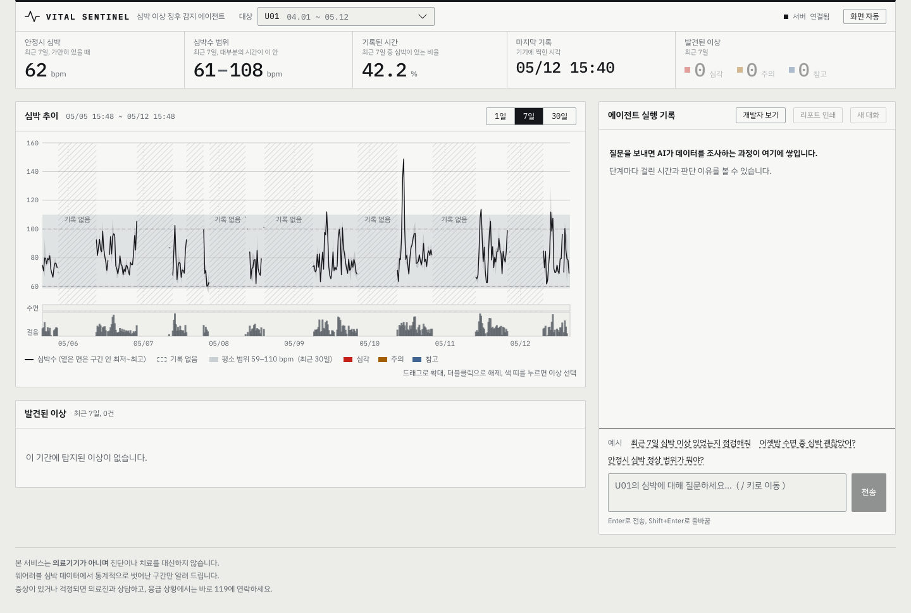
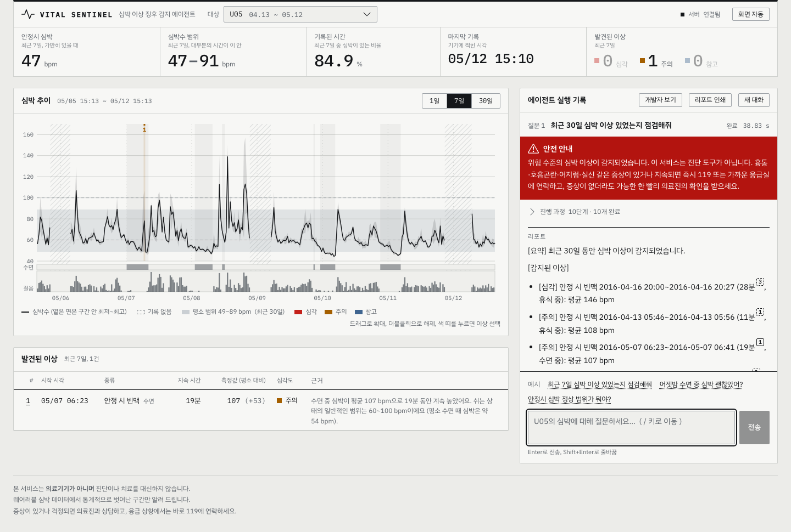
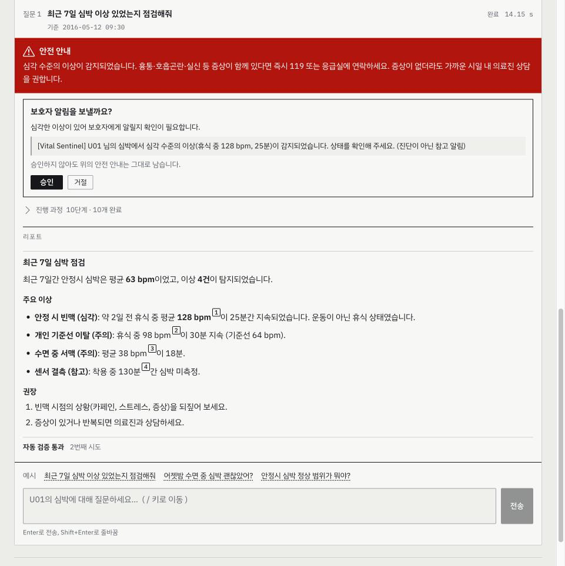
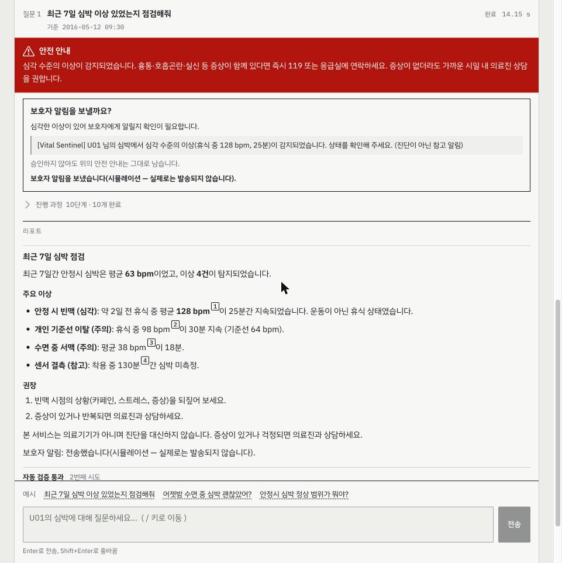
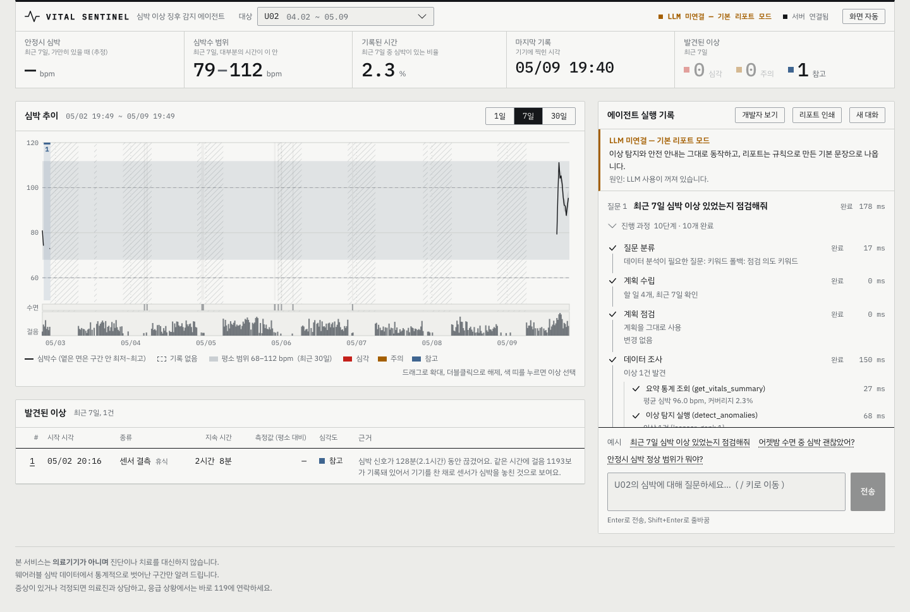
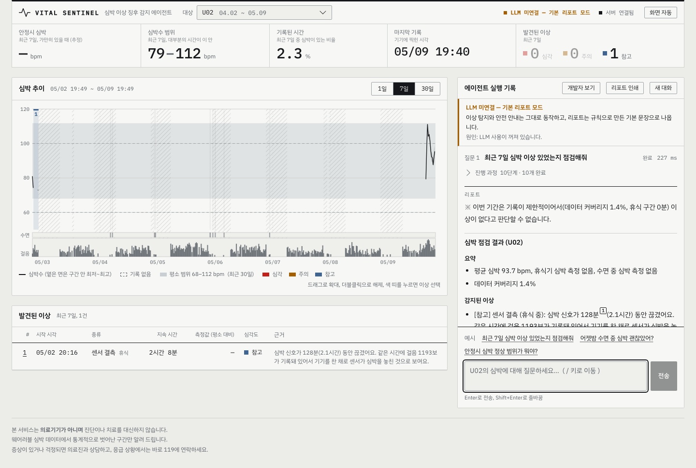
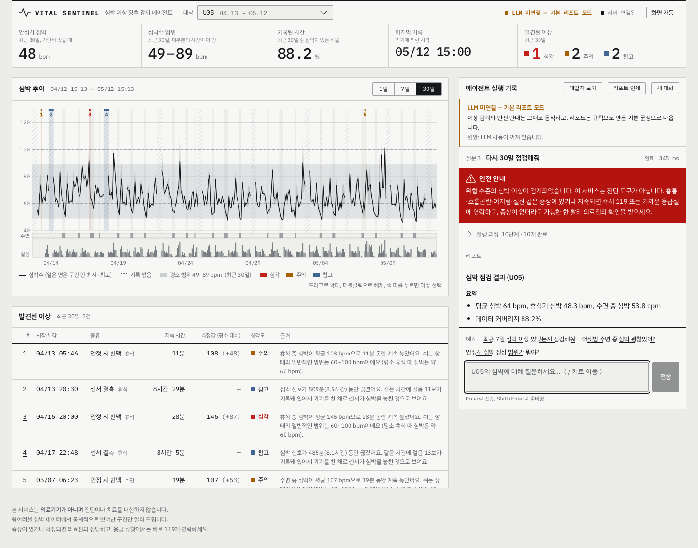
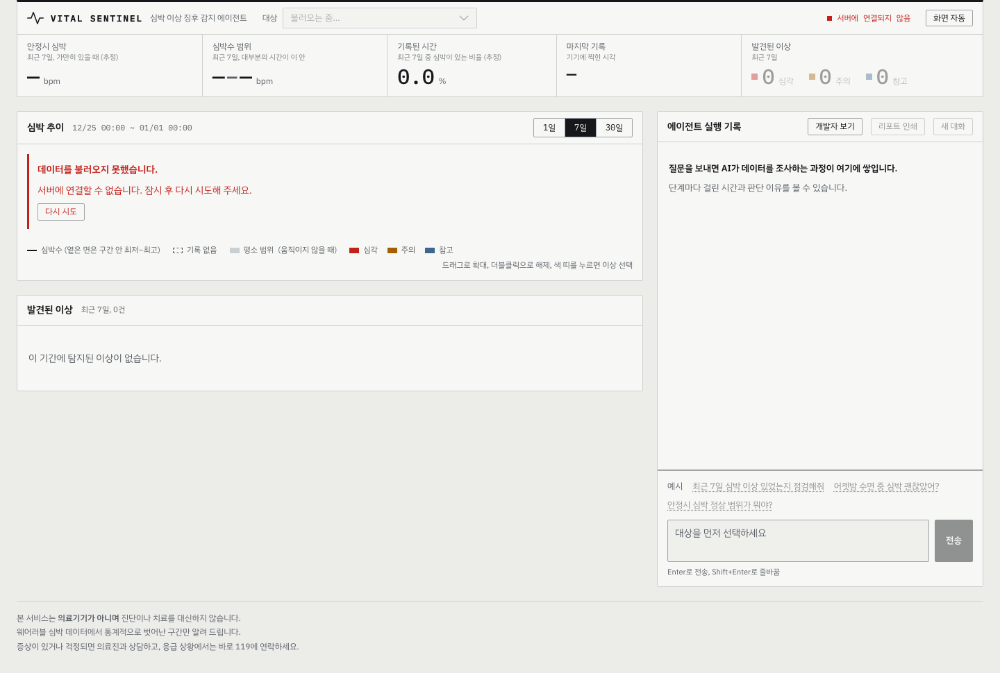

# 사용자 가이드 (Ollama 실모델 기준): 이 에이전트로 무엇을 할 수 있나요?

Vital Sentinel은 손목 밴드가 기록한 심박·걸음·수면에서 이상 징후를 찾아 근거와 함께 한국어로 설명해 주는 에이전트다. 채팅창에 "U05 최근 30일 심박 이상 점검해줘"처럼 말하면 에이전트가 세 가지를 한다.

1. 심박·걸음·수면 기록을 **직접 조회**한다.
2. **규칙으로 이상 구간을 탐지**한다. 탐지는 코드가 하고 LLM은 관여하지 않는다.
3. 건강 가이드라인과 대조해 **근거 수치와 함께 설명**한다. 위험 수준이면 119 안내문이 맨 앞에 붙는다.

> 이 문서는 **켜져 있을 때 무엇을 물어볼 수 있는지**에 집중한다. 켜는 방법과 막힐 때의 대처는 [시작하기](getting-started.md)에 있다.
> 손으로 쳐 볼 질문 목록은 [회귀 테스트 쿼리](regression_test_queries.md), 구조는 [아키텍처 문서](architecture.md)에 있다.
>
> **캡처에 대해.** 아래 화면은 실제 화면을 저장한 것이다(`docs/image_usecase/`). 사용 예 2의 화면만 실제 Ollama 모델로 쓴 리포트이고(당시 구성 `qwen2.5:3b` + `qwen3:8b`. 현재 기본은 `qwen3:0.6b` + `qwen3:8b`) 나머지는 LLM 없이(기본 리포트 모드) 찍은 것이다.
> 기본 리포트 모드에서도 탐지, 안전 안내, 검증은 똑같이 동작하고 리포트 문장만 규칙으로 만든 문장이다. LLM이 쓴 문장은 실행마다 조금씩 달라질 수 있다.
>
> 이 서비스는 **의료기기가 아니며 진단하지 않는다.**

화면은 위쪽에 **판독값 5개**(안정시 심박, 심박 범위, 기록된 시간, 마지막 기록, 발견된 이상 수), 가운데 왼쪽에 **심박 추이**(1일·7일·30일 전환)와 **발견된 이상** 표, 오른쪽에 **에이전트 실행 기록**과 질문 입력창이 있다. 왼쪽 위 `대상`에서 사용자(U01\~U15)를 고른다.

## 한눈에 보는 6가지 사용 예

| # | 이럴 때 | 무엇을 해주나 |
|---|---|---|
| 1 | 가볍게 말을 걸거나 심박 상식이 궁금할 때 | 데이터를 조회하지 않고 바로 답한다. 가이드라인에서 근거를 찾아 쓴다 |
| 2 | "OO 사용자 심박에 이상 있었는지 봐줘" | 심박을 조회하고 이상 구간을 찾아 근거 수치와 함께 설명한다 |
| 3 | 위험한 수치가 나왔을 때 | 안내문(119, 응급실)을 LLM 판단과 무관하게 코드가 리포트 맨 앞에 붙인다. 보호자 알림은 사람이 승인해야 발송된다(시뮬레이션) |
| 4 | 기록이 거의 없는 사용자를 점검할 때 | 조회 기간을 한 번 넓혀 다시 확인하고 그래도 부족하면 "이상이 없다고 판단할 수 없다"고 밝힌다 |
| 5 | 답이 나오기까지 무슨 일이 일어나는지 궁금할 때 | 단계마다 실시간으로 보여 주고 리포트 속 숫자를 눌러 근거 구간을 확인한다 |
| 6 | 조금 전 결과를 이어서 묻고 싶을 때 | 다시 조회하지 않고 직전 결과로 답한다. 서버를 재시작해도 이어진다 |

---

## 사용 예 1: 가볍게 말을 걸고 심박 상식 묻기

점검 대상이 없는 질문에는 무거운 조회를 하지 않는다. 사용자 ID를 말하지 않았거나 일반 지식을 묻는 질문은 곧바로 답한다.

- 질문: `안녕, 너는 누구야?` → 서비스 소개와 예시 질문
- 질문: `휴식기 심박 정상 범위가 어떻게 돼?` → 가이드라인 근거로 답변

입력창 아래의 예시 질문을 눌러도 된다. 질문과 예시가 있는 초기 화면은 아래와 같다.



실제로 일어난 일:

1. **질문 분류**(`route_decided`)가 `simple`로 결정한다. 이유는 화면 실행 기록의 "질문 분류"에 한 줄로 나온다.
2. 계획·게이트·조회 단계(`plan_created`, `anomalies_found` 등)는 **일어나지 않는다.** 심박 데이터 조회가 0건이다.
3. 일반 지식 질문이면 가이드라인 의미 검색(`search_guidelines`, 근거 N건)을 한 번 거친다. 임베딩 서버(Ollama의 `bge-m3`)가 닿지 않으면 키워드 검색으로 내려간다.
4. 답변 끝에 면책 문구가 붙는다.

분류는 작은 LLM(현재 기본 `qwen3:0.6b`)이 하고 코드가 보정한다. "이상", "점검" 같은 점검 의도가 분명한데 사용자를 말하지 않으면 "점검할 사용자를 알려주세요"와 사용자 목록이 나온다.

## 사용 예 2: 사용자 심박을 점검하고 설명 받기

가장 쓸모가 큰 사용 예다. 사용자와 기간을 말하면 에이전트가 직접 심박을 조회하고 이상 구간을 찾아 설명한다.

- 질문: `U05 최근 30일 심박 이상 점검해줘`



위 화면에서 리포트의 숫자 옆 작은 번호는 근거가 된 이상 구간(표의 번호)을 가리킨다. 이 사용자의 30일 안에는 심각 1건(안정 시 빈맥, 휴식 중 평균 146 bpm이 28분), 주의 2건, 참고 2건(센서 결측)이 있다.

실제로 일어난 일:

1. **질문 분류**: 점검 요청이라 `analysis` 경로로 간다.
2. **계획 수립**(`plan_created`): MCP Prompt `anomaly_review`를 표준 점검 절차로 가져와(가져오지 못하면 내장 절차) 할 일 목록(조회, 해석, 작성)과 조회 기간을 정한다. 실행 기록에 하위 단계 **"점검 절차 불러오기"**로 보인다.
3. **계획 점검**(`gate_applied`): 코드가 계획을 확정한다. 점검 의도가 있으면 해석을 빼지 못하고 기간은 1\~30일로 맞춘다.
4. **데이터 조회**(`task_started`/`task_completed` 둘): 요약 통계와 이상 탐지를 **동시에** 실행한다. 이어서 `anomalies_found`로 이상 5건이 화면의 표와 차트에 표시된다.
5. **해석**: LLM이 이상 구간의 의미를 정리한다. 기본은 큰 모델(`qwen3:8b`, `ANALYSIS_TIER=quality`)이다. 탐지 자체는 이미 코드가 끝낸 뒤다.
6. **안전 점검**(`safety_gate`): 심각(critical) 이상이 있는지 코드가 확인한다. 자세한 내용은 사용 예 3.
7. **리포트 작성**(`token`): 큰 모델(`qwen3:8b`)이 리포트를 한 글자씩 쓴다.
8. **검증**(`validation`): 인용한 수치가 조회 결과에 있는지, 진단 단정이나 근거 없는 안심 표현이 없는지 검사한다. 통과하면 "자동 검증 통과 1번째 시도"가 표시된다. 실패하면 한 번 다시 쓰고 그래도 안 되면 규칙 리포트로 대체한다.
9. 끝(`done`).

다른 질문도 해 볼 수 있다. `U03 최근 30일 심박 이상 점검해줘`(서맥 심각 1건), `U12 최근 7일 점검해줘`(이상 없음), `U13 최근 30일 점검해줘`(추세 이상 포함).

**여러 사용자 비교**: `U01이랑 U05 최근 30일 비교해줘`처럼 사용자를 여럿 말하면 최대 3명을 병렬로 조회한다 (`task_started`/`task_completed`가 사용자마다 나오고 안전 게이트도 사용자별로 돈다). critical이 있으면 안내문에 "해당 사용자: U01, U05"처럼 이름이 붙는다. 한 사용자의 조회가 실패해도 다른 사용자의 결과는 나오고 실패한 쪽은 "판단할 수 없다"로 쓴다. 4명 이상을 말하면 앞의 3명만 비교하고 "제외된 사용자"를 한 번 밝힌다. 사용자별 사실을 나란히 설명하는 것이고 우열을 가리지 않는다.

## 사용 예 3: 위험 수치에서 안내를 코드가 강제하고 알림은 승인받기

탐지된 이상 중 심각(critical)이 있으면 에이전트가 무엇을 쓰든 **119·응급실 안내문이 리포트 맨 앞에 붙는다.** 화면의 빨간 "안전 안내" 띠가 이것이다.

- 질문: `U05 최근 30일 심박 이상 점검해줘` (사용 예 2와 같은 질문이다)


실제로 일어난 일:

1. 조회가 끝나면 `safety_gate`가 이상 목록에서 심각도를 직접 확인한다. LLM의 판단은 보지 않는다.
2. 심각 이상이 하나라도 있으면 `safety_escalation`이 발생하고 고정 안내문이 만들어진다. 에스컬레이션은 따로 저장하지 않고 이상 목록에서 매번 다시 도출한다.
3. 안내문은 코드가 리포트 맨 앞에 넣고 LLM 본문에서 같은 문구를 지운다. 그래서 문구가 한 번만 나온다.
4. `analysis`를 건너뛰는 경로로 가도 `safety_gate`는 반드시 거친다.
5. 검증기가 안내문이 있는지 한 번 더 확인한다. 탐지가 실패했을 때도 "이상 없음"이라고 쓰지 않고 "판단할 수 없다"고 쓴다.
6. **보호자 알림 승인**(`HITL_ENABLED`를 켠 경우): 리포트가 끝나면 그래프가 `notify_guardian`에서 멈추고 `approval_required` 이벤트가 `done` 앞에 나온다. 화면에는 빨간 안전 안내 아래에 **"보호자 알림을 보낼까요?"** 카드가 뜬다. 카드에는 보낼 문구의 미리보기와 `승인`, `거절` 버튼이 있다.



7. 승인 또는 거절(`POST /chat/approve`)을 받으면 카드가 결과 한 줄로 바뀌고 리포트 끝에 "보호자 알림: 전송했습니다(시뮬레이션)" 또는 "발송하지 않았습니다"가 붙는다.



위 두 화면은 `MOCK=1`(기록된 시나리오 재생)로 찍은 것이라 리포트 문장은 실제 모델 출력이 아니다. 카드 동작은 실제 화면과 같다.

안전 안내(빨간 띠)는 승인 전에도 후에도 그대로 남는다. 승인은 **시뮬레이션 알림을 보낼지**만 정하고 실제 전송은 일어나지 않는다. 카드에도 "승인하지 않아도 위의 안전 안내는 그대로 남습니다"라고 적혀 있다. 승인을 기다리는 중에 새 질문을 하면 자동으로 거절 처리되고 대화가 이어진다. 서버를 sqlite 기억으로 켜면 재시작 뒤에도 대기가 남는다.

반대로 critical이 없는 질문에는 안내문이 붙지 않는다. 평가에서 critical 질의 4건 모두 안내문이 붙었고 critical이 아닌 질의에 붙은 경우는 0건이었다.

## 사용 예 4: 기록이 부족하면 기간을 넓혀 다시 조사하기

웨어러블은 기록이 비는 경우가 많다. 기록이 부족한 사용자를 점검하면 "이상 없음"이라고 말하지 않고 한 번 더 넓게 확인한 뒤 한계를 밝힌다.

- 질문: `U02 최근 7일 심박 점검해줘` (U02는 7일 기록이 2.3%뿐이다)



실제로 일어난 일:

1. 조회(`task_*`, `anomalies_found`)에서 **커버리지 2.3%**가 나온다. 50% 미만이면 데이터가 부족하다고 판단한다.
2. **재계획**(`replan`): "데이터 커버리지 2.3% < 50% → 조회 기간 확대", 7일에서 **14일**로 넓혀 다시 조회한다. 확대는 최대 1회다.
3. 14일로 봐도 1.4%라 부족하다. 더 넓히지 않고 그대로 진행한다.
4. 리포트 맨 위에 코드가 고정 문구를 붙인다.



"※ 이번 기간은 기록이 제한적이어서(데이터 커버리지 1.4%, 휴식 구간 0분) 이상이 없다고 판단할 수 없습니다."가 그 문구다. 감지된 이상은 센서 결측(참고) 1건이다. 걸음은 기록되는데 심박이 2시간 넘게 비어 있어서 기기를 찬 채 센서가 놓친 것으로 본다.

재계획이 효과를 내는 사례는 `U08 최근 7일 심박 이상 점검해줘`다. 7일 커버리지가 48.6%인데 14일로 넓히면 69.4%가 되어 부족 판정이 풀린다.

## 사용 예 5: 에이전트가 무엇을 하는지 실시간으로 보기

답이 나오는 동안 **오른쪽 실행 기록**에 단계가 쌓이고 단계마다 걸린 시간이 표시된다. 같은 내용이 서버에서 SSE 이벤트로 전송되어 화면이 그대로 그린다. 브라우저는 Vite 개발 서버(8600)로 요청을 보내고 이 서버가 `/api` 요청을 FastAPI(8100)로 중계한다.


위 화면은 답이 끝난 뒤의 모습이다.

보는 법:

1. **진행 과정 10단계**: 질문 분류, 계획 수립, 계획 점검(게이트), 데이터 조회, (필요하면) 재조사, 해석, 안전 점검, 리포트 작성, 검증, 마무리. 단계 오른쪽의 숫자가 걸린 시간이다.
2. **빨간 띠**: 안전 게이트가 켜진 경우다. 안내문은 코드가 만든 고정 문구라 LLM이 바꾸지 못한다.
3. **리포트의 작은 숫자**: 누르면 해당 이상이 차트의 색 띠와 아래 표에서 강조된다.
4. **하위 단계 표시**: 실행 기록에 "점검 절차 불러오기"(MCP Prompt, 계획 단계 안)와 "가이드라인 검색"(RAG, 일반 질문의 답변 단계 안)이 아이콘과 함께 한 줄씩 나온다. 일시 오류로 다시 시도했다면 "재시도 N회"가 그 단계에 붙는다.
5. **LLM 미연결 표시**: 오른쪽 위에 "LLM 미연결 — 기본 리포트 모드"가 보이면 Ollama에 연결되지 않은 상태다. 탐지와 안전 안내는 똑같이 동작하고 리포트 문장만 규칙으로 만든다.
6. **개발자 보기**: 노드 이름과 이벤트 원문 같은 내부 정보를 켜고 끈다. 평소에는 꺼 둔다.
7. **리포트 인쇄**: 리포트, 이상 표, 면책만 깔끔하게 출력한다. **새 대화**는 대화를 비우고 처음부터 시작한다.
8. 답을 기다리다 브라우저 탭을 닫으면 서버가 해당 그래프 실행을 취소한다.

서버를 켜지 않고 화면만 보려면 `MOCK=1 bash sh/run_frontend.sh`다. 이때 화면은 기록된 시나리오를 재생하는 것이다.

## 사용 예 6: 조금 전 결과를 이어서 묻기 (서버 재시작 후에도)

같은 대화 안에서 직전 결과를 이어서 물으면 데이터를 다시 조회하지 않는다.

- 질문 1: `U05 최근 30일 심박 이상 점검해줘`
- 질문 2: `방금 결과에서 빈맥이 뭔지 쉽게 설명해줘`
- 질문 3: `다시 30일 점검해줘`



위 캡처는 질문 3을 입력한 뒤의 화면이다. 119 안내(빨간 띠)가 유지되고 같은 30일 창으로 다시 점검했다.

실제로 일어난 일:

1. 질문 2: 코드가 **후속 질문으로 판정**하고(`route_decided` 사유에 "이전 분석에 대한 후속 질문") `simple`로 강제한다. 조회하지 않고 직전 분석 결과로 답하며 **119 안내문이 다시 붙는다.**
   직전 분석이 있고 새 점검 요구(다른 사용자, 기간, "점검/다시/확인해" 같은 말)가 없으면 LLM의 분류와 무관하게 이렇게 처리한다.
2. 질문 3: "다시 점검해줘"는 새 점검 요구라 재분석이 돈다. 기간을 말하지 않았으므로 `gate_applied`에 "기간 미지정 → 직전 분석 창 30일 이어받음"이 나온다. 더 짧은 기본 7일 창으로 바뀌어 앞서 본 위험이 사라지는 것을 막는 장치다.
3. **이름·나이도 기억한다.** 같은 대화에서 `제 이름은 민수입니다`라고 말한 뒤 `제 이름이 뭐였죠?`라고 물으면 코드가 기록에서 "민수님이라고 말씀하셨어요"로 답한다(도구 조회 없이 simple). 말한 적 없는 값은 "아직 말씀해 주지 않으셨어요"라고 인정하고 다른 대화로 새지 않는다. sqlite 기억이면 서버를 재시작해도 유지된다.
4. 같은 대화로 이어지는 이유: 서버가 `thread_id`별로 대화 상태를 저장한다. 화면은 사용자별 대화 번호를 브라우저에 기억한다.

**서버 재시작 후 기억**: 실행 스크립트(`sh/run_agent_*.sh`)는 대화 상태를 sqlite 파일에 저장한다. 서버를 껐다 켜도 같은 `thread_id`로 이어 물을 수 있다. 직접 `uvicorn`으로 켜면 기본 저장소는 메모리라 `CHECKPOINTER=sqlite`를 줘야 한다.

```bash
bash sh/run_agent_fake.sh                          # 또는 run_agent_ollma.sh
# 질문 → Ctrl+C 로 서버 종료 → 같은 명령으로 다시 켜기 → 같은 thread_id 로 질문
curl -s -X POST localhost:8100/chat -H 'Content-Type: application/json' \
  -d '{"message":"아까 결과 다시 요약해줘","user_id":"U05","thread_id":"<응답에 있던 thread_id>"}'
```

대화 상태는 `data/checkpoints.sqlite`에 남는다. 영속성은 `tests/test_graph.py`의 sqlite 테스트로 확인한다.

---

## 운영자용: 품질을 자동으로 확인하는 방법

질문을 손으로 치는 대신 같은 질문 묶음으로 품질을 숫자로 확인할 수 있다. 모든 명령은 프로젝트 루트에서 실행한다.

| 무엇을 확인하나 | 명령 | 결과 위치 |
|---|---|---|
| 에이전트 종단 평가 26건 (라우팅, 에스컬레이션, 진단 단정, 면책, 수치 근거, 지연, 폴백) | `.venv/bin/python -m eval.langsmith_eval --offline` (LangSmith 연동은 `--offline` 없이) | `eval/results/agent_eval.md` |
| 블라인드 홀드아웃 16건 | `.venv/bin/python -m eval.heldout_eval` | `eval/results/heldout_eval*.md` |
| v1 대 v2 Before/After | `.venv/bin/python -m eval.compare_versions` (`--backend fake`는 배선 확인용) | `eval/results/before_after.md` |
| 탐지기 재현율과 알림 부담 | `.venv/bin/python -m eval.detection_eval`, `eval.robustness_benchmark` | `eval/results/detection_eval.md`, `robustness_benchmark.md` |
| 가이드라인 검색 정확도 (키워드 대 RAG) | `.venv/bin/python -m eval.rag_eval` | `eval/results/rag_eval.md` |
| 실패한 예제를 회귀셋으로 모으기 | `.venv/bin/python -m eval.promote_failures` (기본은 드라이런, 기록은 `--apply`) | LangSmith 데이터셋 `vital-sentinel-regression` |
| 단위·통합·E2E 테스트 | `LLM_ENABLED=false .venv/bin/python -m pytest -q`, `cd frontend && npm test`, `npm --prefix e2e test` | 터미널 |

**블라인드 홀드아웃 14/16의 의미.** 개발 평가 26건은 에이전트를 만든 쪽이 만든 질문이라 거의 만점이다. 코드를 보지 않고 만든 16건을 처음 돌렸을 때 14건이 통과했다(88%, 95% 구간 64\~96%, 측정 당시 fast 모델 `qwen2.5:3b`). 이 첫 실행만 블라인드다. 실패를 고친 뒤의 재실행(16/16, 15/16)은 같은 질문을 본 뒤라 일반화 근거로 쓰지 않는다. 그래서 `promote_failures`도 홀드아웃 질문은 회귀셋에 옮기지 않는다.

LangSmith로 요청 하나의 단계별 트리를 보려면 `.env`에 `LANGCHAIN_TRACING_V2=true`와 키를 넣는다. 트레이스에는 질문, 리포트, 집계 사실이 외부로 전송된다.

### 실행 모드 비교

| | LLM 없음 (`run_agent_fake.sh`) | 로컬 Ollama (`run_agent_ollma.sh`) | OpenAI (`run_agent_openai.sh`) |
|---|---|---|---|
| 비용 | 없음 | 없음 (로컬 추론) | **과금** (y/N 확인) |
| 탐지·안전 안내·검증 | 동작 | 동작 | 동작 |
| 리포트 문장 | 규칙으로 만든 기본 리포트 | LLM이 작성 (`qwen3:8b`) | LLM이 작성 |
| 질문 분류·계획 | 키워드 폴백, 규칙 계획 | `qwen3:0.6b` + 코드 보정 | OpenAI 모델 + 코드 보정 |
| 한 건 소요 | 약 0.2초 | 분석 경로 p50 33.5초, p95 71.0초 (M4 Pro, 공유 Ollama. 측정 당시 구성 fast `qwen2.5:3b`, 현재 기본 구성(fast `qwen3:0.6b` + analysis 8b)은 40건 전체 p50 23.47초, p95 72.27초(2026-10-20 22:16 측정)이고 분석 경로만의 값은 이보다 길다) | 측정 예정 |
| 용도 | 처음 써 보기, 화면 확인, 장애 시연 | 기본 사용 | 모델 비교 |

OpenAI 모드는 `.env`의 `OPENAI_API_KEY`가 필요하다. 모든 요청이 과금되므로 확인 없이는 시작하지 않는다. 스크립트(`bash sh/run_agent_openai.sh`)는 y/N을 묻고 `.env`나 셸에 `OPENAI_CONFIRM`이 미리 적혀 있어도 일부러 무시한다(확인을 건너뛰는 통로가 되기 때문이다).

Docker로 한 번만 과금 모드로 띄우려면 이 프로세스에서만 확인값을 준다.

```bash
docker compose run --rm -e OPENAI_CONFIRM=yes -e LLM_BACKEND=openai --service-ports backend
```

이 명령은 백엔드만 올린다(`.env`의 키를 읽고 `127.0.0.1:8100`에만 연다). 화면은 따로 `bash sh/run_frontend.sh`로 붙인다. `.env`에는 확인값을 쓰지 않는다. 로컬 모드가 데이터를 외부로 보내지 않는 것이 이 프로젝트의 기본 전제다.

## (참고) LLM이 없을 때

Ollama가 꺼져 있거나 모델이 없어도 에이전트는 끝까지 동작한다. 화면에 "LLM 미연결 — 기본 리포트 모드"가 표시되고 탐지, 안전 안내, 검증은 그대로이며 리포트만 규칙 문장으로 나온다. 평가에서는 Ollama 주소를 닫힌 포트로 바꾼 상태의 성공률 1.0, 지연 평균 0.5초였다.

MCP 서버 둘 중 하나가 죽어도 에이전트는 계속 답한다. 문서 서버가 죽으면 일반 질문이 번들 요약으로 나오고 데이터 서버가 죽으면 점검 질문이 "이상 탐지를 실행하지 못해 판단할 수 없다"는 안내를 붙인 리포트로 끝난다. LLM을 끄면 문서 검색도 임베딩을 부르지 않고 키워드 검색으로 내려간다.

백엔드 서버 자체가 꺼져 있으면 화면이 "데이터를 불러오지 못했습니다"와 "다시 시도" 버튼을 보여 준다.



## 더 알아보기

- 켜는 방법, 수동 실행, 막힐 때: [시작하기](getting-started.md#주요-실행-방법)
- 구조: [아키텍처 구성도](architecture.md#아키텍처-구성도), [유스케이스별 시퀀스 다이어그램](architecture.md#주요-유스케이스별-시퀀스-다이어그램)
- 손으로 쳐 볼 질문 23개: [`regression_test_queries.md`](regression_test_queries.md)
- 수치와 한계: [KPI와 Before/After](evaluation.md#kpi와-beforeafter), [한계와 로드맵](evaluation.md#한계와-로드맵)
